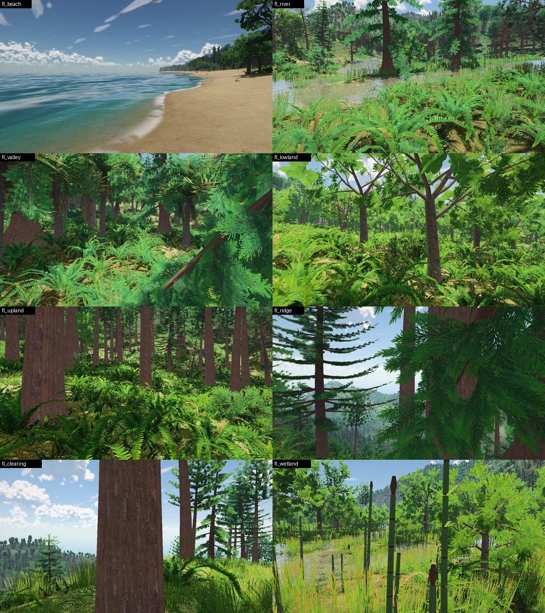

# Flora: species, communities and food

What grows on the island, where and why, what each plant offers to eat, and
how the renderer draws it. Plants are placed from the world bake's eight
vegetation layers (`terra/terra.c`, `TERRA_VEG_*`); this document covers
what is derived from them at load.

## 1. Taking stock (before)

Eight viewpoints, one in each kind of country, found from the world data by
`tools/floraprobe.c` (`make -C ocean/cretaceous floraprobe`, run from the
repository root; it prints them as a `CRET_SHOT_CAM` string). Each is 1.8 m
over the ground, an adult's eye. The island (seed 1) has no lakes: every
inland water cell is river, so the pond or wetland view is the flattest,
muddiest slow reach of river with horsetails.

```bash
CRET_SHOT_CAM="$(./build/cretaceous/floraprobe)" \
  ./build/cretaceous/cretaceous capture DIR --size 1280 720 --shot 'fl_*'
```

| site | where | layers within 40 m (0..1) |
|---|---|---|
| `fl_beach` | 2128, 4024, 0.6 m | broadleaf 0.23, palm 0.24, fern 0.17 |
| `fl_river` | 2968, 4288, 58 m | conifer 0.55, broadleaf 0.24, fern 0.51, horsetail 0.08 |
| `fl_valley` | 2800, 5728, 30 m | tree fern 0.75, broadleaf 0.48, conifer 0.42, fern 0.59 |
| `fl_lowland` | 2536, 4360, 22 m | broadleaf 0.90, fern 0.66, tree fern 0.15 |
| `fl_upland` | 3736, 3592, 357 m | conifer 0.85, fern 0.56, shrub 0.28, cycad 0.14 |
| `fl_ridge` | 5176, 3616, 392 m | conifer 0.51, shrub 0.31, cycad 0.28, fern 0.35 |
| `fl_clearing` | 3952, 5824, 393 m | conifer 0.54, cycad 0.26, fern 0.38, shrub 0.30 |
| `fl_wetland` | 2680, 3520, 39 m | broadleaf 0.64, fern 0.55, horsetail 0.18 |



What grows there now, and why it reads as fake:

- **The same few plants everywhere.** Every site from the beach to 390 m has
  the same ground fern (one species, two photo fronds, at different sizes),
  the same shrub and the same sward. A kind's eight variants are four tree
  species, but the ground kinds (fern, horsetail, shrub) are one species
  each, and the four tree species of a kind are picked by a 140 m hash with
  only one habitat rule (metasequoia on wet ground). So the valley floor,
  the lowland forest and the upland forest differ only in the conifer to
  broadleaf share.
- **No open ground.** The bake makes forest the default cover: the probe
  could not find a clearing anywhere inland. The `fl_clearing` view, the
  thinnest canopy ringed by forest, still has a trunk in front of the lens.
  There are no gaps at the 50-200 m scale, so walking anywhere looks the
  same.
- **No understorey structure.** Under the canopy there is one layer, ferns at
  knee height, then trunks. No saplings, no small understorey trees, no
  shade ferns different from the open-ground ones, no mosses or clubmosses.
- **No zonation.** Along the river (`fl_river`, `fl_wetland`) the ferns run
  to the waterline and conifers stand in the river; horsetails are the only
  water-margin plant, and the same grass and sedge grow at every bank. Up
  the slope the mix only shifts from broadleaf to conifer: the dry ridge
  (`fl_ridge`) is conifer forest with ferns, not cycad scrub. The beach goes
  from sand straight into broadleaf forest; palms are thin, and there is no
  strand scrub.
- **Nothing dead.** No standing dead trees; logs and stumps lie about
  (props) but no tree stands broken or dead, and nothing grows on the logs.
- **Nothing in flower or fruit.** No flowers, cones, seeds or fruit on any
  plant and nothing fallen under them, so nothing tells a herbivore (or a
  player) where food is, and the forest reads as plastic greenery.
- **No still water plants.** No water lilies or floating plants; there is no
  still water on this island except slow river reaches.
