# Procedural dinosaurs

`tools/blender/dino_build.py` builds every species from code in the repository: skeleton, skinned body, baked textures and all thirteen clips `render/dino.c` plays. It exists because the game's own dinosaurs are CC BY downloads that need a browser login (`assets/dinos/CREDITS.md`), so they are in neither the repository nor the cloud sandbox, and several of them have only a few clips (the gallimimus one run, the sauropelta one walk; the rest are copied from the raptor).

**Licence.** Everything here is generated by code in this repository: no mesh, texture, scan or motion capture is downloaded or read. The inputs are the species specs in `tools/blender/species/` (proportions written in our own words from the published skeletal work each spec names) and the species table in `sim.c`. The generated files carry no third-party licence, so the credits of `assets/dinos/CREDITS.md` do not apply to them (the HUD's credits screen still lists those models, since it reads that file).

## Building and loading

```bash
ocean/cretaceous/tools/build_proc_dinos.sh                  # all six, about 10 minutes on 4 cores
ocean/cretaceous/tools/build_proc_dinos.sh raptor galli     # some
CRET_DINO_DIR=ocean/cretaceous/assets/dinos_proc ./build/cretaceous/play
```

Run from the repository root. Needs Blender 4.2 (`BLENDER=/path/to/blender` if it is not on the path) and python3. The script builds each species in Blender (`blender -b --factory-startup --disable-autoexec`), converts the glTF with `tools/dino_convert.py` (the same converter as the downloaded models: `--length` and `--speed` from the sim's table, 1K textures), writes `SPECIES.dino` and `SPECIES_hide_{diff,nor,arm}.jpg` into `DINO_OUT` (default `ocean/cretaceous/assets/dinos_proc`, gitignored: build outputs, never committed) and then runs `animcheck --check` on what it wrote; it exits non-zero when a limit is broken. Other settings: `DINO_TMP` (the intermediate glTFs, default `build/cret_proc_dinos`), `DINO_RENDER=DIR` (also write the review renders, below) and `DINO_SAMPLES` (Cycles samples, 64).

The game reads its `.dino` files and textures from `CRET_DINO_DIR` when it is set (`render/dino.c`, `dino_dir`), else from `assets/dinos`. A species missing from that folder is drawn as it is without a model (`cret_dino_has` is false for it). The texture cache key hashes the texture files' paths and contents, so switching folders decodes the other set once and both stay cached. The raptor's albedo is still warmed by `SPECIES_TINT`, which was tuned for the downloaded raptor.

## What it builds

From the spec (fractions of the body length) and the sim's length:

- **Skeleton**: hips, spine, neck, head and jaw, tail, and legs named as `render/dino_ik.c` finds them (`upperleg/lowerleg/ankle/toe.L|R` on bipeds; `upperleg/lowerleg/backfoot/backtoe` and `upperarm/lowerarm/foot/fronttoe` on quadrupeds, the stegosaur's names), so the foot IK and the converter's foot speed both work. 32 to 35 joints. The standing legs are posed by the same two-bone solve the clips use, and the whole is scaled so snout to tail tip is exactly the sim's length.
- **Body**: metaball ellipsoids along the spine, neck and tail (width, back and belly from the spec's girth tables), cranium, snout and jaw, tapering tubes for the limbs and three splayed toes; voxel-remeshed into one closed surface, smoothed and decimated to about 22k triangles (LOD0; the converter makes LOD1 and LOD2 at 30% and 8%). Plates, thagomizer spikes, osteoderms, neck spikes, dome knobs, brow horns, claws, the raptor's sickle claw and the eyes are separate small meshes joined on afterwards, each weighted rigidly to its bone.
- **Weights**: Blender's automatic (bone heat) weights, cleaned: a vertex keeps only joints within two bones of its nearest in the hierarchy, never a joint of the other side, at most four, renormalised.
- **UVs and textures**: smart-project UVs, then baked at 1K from procedural shader nodes in rest-pose space: albedo (countershading, pale where the surface faces down and darker along the back, and a pattern per species: raptor stripes, stegosaur blotches, tyrannosaur mottle, pachycephalosaur spots, sauropelta bands across the armour, gallimimus a dark dorsal saddle; feather streaks on the raptor and gallimimus; keratin on claws and horns, dark eyes), a tangent-space normal map with scales (Voronoi cells and fine wrinkles), and ARM (baked ambient occlusion, roughness, no metal).

## The clips

All thirteen roles of `render/dino.c`'s table: idle, idle2, walk, trot, run, jump, eat, drink, call, attack, sleep, hurt and death. Every frame is posed by code: the root's offset and rotation, rotations spread along the spine, neck and tail, and an IK target per leg (ball of the foot, metatarsus angle, toe pitch). Looping clips are sampled over one whole period, so the last frame equals the first.

**Gaits** run at the sim's walk, trot and sprint speeds (stored as such with `--speed`, and matching the planted feet: the `feet` column below). Bipeds alternate their feet; the stegosaur and sauropelta walk and run in lateral sequence (left hind, left fore, right hind, right fore a quarter cycle apart) and trot in diagonal pairs. Body bob, a little yaw and roll of the hips, the chest counter-turning and a travelling wave down the tail against the hips come with every gait.

- **Stride** starts from leg length (Alexander 1976: stride / hip height = 2.3 (v² / g h)^0.3) and is rounded to whole frames. For each stride the hips drop as little as lets every planted leg reach its ball through the stance, at most 6% of the hip height; if none fits, the stride shortens (or, for a biped's trot and run, the time each foot is down).
- **Planted feet** stay exactly on the ground: a planted ball moves back at exactly the ground speed. In a walk the knee takes up the change of reach and the metatarsus keeps its standing angle to the hip-to-ball line; in a biped's trot and run, where a stance lasts only two to six frames, the hips vault over the planted foot at the height that keeps the leg's shape, so in stance only the hip joint turns.
- **Swing**: the foot leaves and lands at the ground speed (eased over a few frames), rises at once and returns on a smooth arc; the metatarsus angle runs smoothly from its value at lift-off to its value at the next touchdown, and the toes curl in the air. The lift is the highest that keeps every joint under 29 degrees a frame (animcheck's limit is 30): at 30 frames a second a fast swing folds the knee quickly.

The other clips: idle (breathing, small head and tail motion) and idle2 (looks round, shakes the head); eat (a carnivore tugs at a carcass, a herbivore crops), drink (head down, the jaw lapping); call (head up, jaws open); attack per species (bite, tail swing, headbutt, shoulder bash, kick) with its hit frame at the spec's time; hurt (a flinch from the standing pose back to it); jump (crouch, tuck, land); sleep (the legs folded, the body lowered until it rests on the ground, the head down beside it); death (a stagger, then rolled onto the left side and lifted so nothing sinks into the ground).

What the generator chose per gait (it prints this as it builds):

| Species | Gait | m/s | Stride m | Cycle s (frames) | Duty | Hips lower m | Lift m | Largest step deg |
|---|---|---|---|---|---|---|---|---|
| raptor | walk | 2.20 | 1.17 | 0.53 (16) | 0.62 | 0.05 | 0.12 | 28.7 |
| raptor | trot | 4.60 | 2.45 | 0.53 (16) | 0.28 | 0.02 | 0.21 | 28.1 |
| raptor | run | 8.60 | 3.44 | 0.40 (12) | 0.17 | 0.05 | 0.10 | 28.6 |
| stego | walk | 2.20 | 1.69 | 0.77 (23) | 0.70 | 0.13 | 0.27 | 28.4 |
| stego | trot | 3.40 | 2.83 | 0.83 (25) | 0.50 | 0.17 | 0.32 | 27.5 |
| stego | run | 4.60 | 3.37 | 0.73 (22) | 0.45 | 0.20 | 0.49 | 26.3 |
| trex | walk | 1.50 | 3.20 | 2.13 (64) | 0.64 | 0.12 | 0.37 | 13.5 |
| trex | trot | 3.20 | 5.01 | 1.57 (47) | 0.50 | 0.16 | 0.60 | 19.9 |
| trex | run | 6.40 | 7.68 | 1.20 (36) | 0.33 | 0.15 | 0.82 | 24.0 |
| pachy | walk | 1.70 | 1.81 | 1.07 (32) | 0.62 | 0.08 | 0.19 | 20.0 |
| pachy | trot | 3.70 | 2.96 | 0.80 (24) | 0.37 | 0.04 | 0.32 | 20.4 |
| pachy | run | 7.00 | 4.43 | 0.63 (19) | 0.23 | 0.06 | 0.32 | 27.3 |
| sauropelta | walk | 1.30 | 0.95 | 0.73 (22) | 0.70 | 0.06 | 0.13 | 25.3 |
| sauropelta | trot | 2.20 | 1.54 | 0.70 (21) | 0.50 | 0.08 | 0.18 | 26.5 |
| sauropelta | run | 3.10 | 1.86 | 0.60 (18) | 0.45 | 0.09 | 0.23 | 25.0 |
| galli | walk | 2.20 | 2.86 | 1.30 (39) | 0.60 | 0.09 | 0.32 | 22.1 |
| galli | trot | 5.00 | 4.67 | 0.93 (28) | 0.35 | 0.06 | 0.51 | 23.6 |
| galli | run | 9.00 | 6.60 | 0.73 (22) | 0.25 | 0.11 | 0.45 | 26.7 |

## animcheck

`./build/cretaceous/animcheck --check` on the six generated files (docs/testing.md explains the columns and limits). All six pass: `animcheck: ok (6 files, 0 problems)`. Per clip (slide in % of the speed for gaits, cm/s for clips that stand; seams of the clips the converter marks as loops):

| Species | Clip | Speed / feet m/s | Slide | Below cm | Seam deg / cm | Step deg |
|---|---|---|---|---|---|---|
| raptor | attack | 0.00 / -0.00 | 0.0cm/s | -0.00 | 0.04 / 0.00 | 29.1 |
| raptor | call | 0.00 / -0.00 | 0.0cm/s | -0.00 | 0.04 / 0.00 | 6.2 |
| raptor | death | 0.00 / 0.00 | 68.1cm/s | 0.08 | - / - | 5.2 |
| raptor | drink | 0.00 / -0.00 | 0.0cm/s | 0.00 | 0.06 / 0.00 | 0.7 |
| raptor | eat | 0.00 / -0.00 | 0.0cm/s | 0.00 | 0.06 / 0.00 | 2.6 |
| raptor | hurt | 0.00 / 0.00 | 0.0cm/s | -0.00 | 0.04 / 0.00 | 7.2 |
| raptor | idle | 0.00 / -0.00 | 0.0cm/s | -0.00 | 0.04 / 0.00 | 0.1 |
| raptor | idle2 | 0.00 / 0.00 | 0.0cm/s | -0.00 | 0.04 / 0.00 | 1.4 |
| raptor | jump | 0.00 / 0.00 | 4.8cm/s | -0.00 | 0.04 / 0.00 | 9.9 |
| raptor | run | 8.60 / 8.61 | 0.1% | 0.02 | 0.04 / 0.00 | 28.6 |
| raptor | sleep | 0.00 / -0.00 | 0.0cm/s | -0.36 | 0.04 / 0.00 | 0.0 |
| raptor | trot | 4.60 / 4.60 | 0.1% | 0.00 | 0.04 / 0.00 | 28.1 |
| raptor | walk | 2.20 / 2.20 | 0.1% | -0.01 | 0.04 / 0.00 | 28.7 |
| stego | attack | 0.00 / -0.00 | 0.0cm/s | -0.01 | 0.04 / 0.00 | 6.3 |
| stego | call | 0.00 / -0.00 | 0.3cm/s | -0.00 | 0.04 / 0.00 | 17.8 |
| stego | death | 0.00 / -0.00 | 130.8cm/s | 0.95 | - / - | 5.2 |
| stego | drink | 0.00 / -0.00 | 0.0cm/s | 0.00 | 0.04 / 0.00 | 0.7 |
| stego | eat | 0.00 / -0.00 | 0.0cm/s | 0.00 | 0.04 / 0.00 | 1.3 |
| stego | hurt | 0.00 / 0.00 | 0.0cm/s | -0.00 | 0.04 / 0.00 | 7.7 |
| stego | idle | 0.00 / -0.00 | 0.0cm/s | -0.00 | 0.04 / 0.00 | 0.1 |
| stego | idle2 | 0.00 / -0.00 | 0.0cm/s | -0.00 | 0.04 / 0.00 | 1.4 |
| stego | jump | 0.00 / 0.00 | 13.3cm/s | -0.00 | 0.04 / 0.00 | 25.9 |
| stego | run | 4.60 / 4.60 | 0.0% | -0.06 | 0.04 / 0.00 | 26.3 |
| stego | sleep | 0.00 / -0.00 | 2.0cm/s | -0.09 | 0.04 / 0.00 | 0.1 |
| stego | trot | 3.40 / 3.40 | 0.0% | -0.06 | 0.04 / 0.00 | 27.5 |
| stego | walk | 2.20 / 2.20 | 0.0% | -0.06 | 0.04 / 0.00 | 28.4 |
| trex | attack | 0.00 / -0.00 | 0.0cm/s | -0.00 | 0.04 / 0.00 | 29.1 |
| trex | call | 0.00 / -0.00 | 0.0cm/s | -0.00 | 0.04 / 0.00 | 6.2 |
| trex | death | 0.00 / -0.05 | 275.3cm/s | 0.42 | - / - | 5.2 |
| trex | drink | 0.00 / 0.00 | 0.0cm/s | -0.00 | 0.04 / 0.00 | 0.7 |
| trex | eat | 0.00 / 0.00 | 0.0cm/s | -0.00 | 0.04 / 0.00 | 2.6 |
| trex | hurt | 0.00 / 0.00 | 0.0cm/s | -0.00 | 0.04 / 0.00 | 7.2 |
| trex | idle | 0.00 / 0.00 | 0.0cm/s | -0.00 | 0.04 / 0.00 | 0.1 |
| trex | idle2 | 0.00 / -0.00 | 0.0cm/s | -0.00 | 0.04 / 0.00 | 1.4 |
| trex | jump | 0.00 / 0.00 | 18.4cm/s | -0.00 | 0.04 / 0.00 | 11.1 |
| trex | run | 6.40 / 6.40 | 0.1% | 0.04 | 0.04 / 0.00 | 24.0 |
| trex | sleep | 0.00 / -0.00 | 0.0cm/s | 0.07 | 0.04 / 0.00 | 0.0 |
| trex | trot | 3.20 / 3.20 | 0.1% | -0.02 | 0.04 / 0.00 | 19.9 |
| trex | walk | 1.50 / 1.50 | 0.5% | -0.02 | 0.04 / 0.00 | 13.5 |
| pachy | attack | 0.00 / -0.00 | 0.0cm/s | -0.00 | 0.04 / 0.00 | 5.5 |
| pachy | call | 0.00 / -0.00 | 0.0cm/s | -0.00 | 0.04 / 0.00 | 6.2 |
| pachy | death | 0.00 / -0.00 | 113.0cm/s | 0.03 | - / - | 5.2 |
| pachy | drink | 0.00 / -0.00 | 0.0cm/s | -0.00 | 0.04 / 0.00 | 0.7 |
| pachy | eat | 0.00 / -0.00 | 0.0cm/s | -0.00 | 0.04 / 0.00 | 1.3 |
| pachy | hurt | 0.00 / -0.00 | 0.0cm/s | -0.00 | 0.04 / 0.00 | 7.2 |
| pachy | idle | 0.00 / -0.00 | 0.0cm/s | -0.00 | 0.04 / 0.00 | 0.1 |
| pachy | idle2 | 0.00 / 0.00 | 0.0cm/s | -0.00 | 0.04 / 0.00 | 1.4 |
| pachy | jump | 0.00 / 0.00 | 7.8cm/s | -0.00 | 0.04 / 0.00 | 10.4 |
| pachy | run | 7.00 / 7.02 | 1.4% | 0.05 | 0.04 / 0.00 | 27.3 |
| pachy | sleep | 0.00 / -0.00 | 0.0cm/s | -0.68 | 0.04 / 0.00 | 0.0 |
| pachy | trot | 3.70 / 3.71 | 0.3% | 0.00 | 0.04 / 0.00 | 20.4 |
| pachy | walk | 1.70 / 1.70 | 0.3% | -0.03 | 0.00 / 0.00 | 20.0 |
| sauropelta | attack | 0.00 / -0.00 | 0.0cm/s | -0.00 | 0.76 / 0.82 | 20.9 |
| sauropelta | call | 0.00 / -0.00 | 0.0cm/s | -0.00 | 0.04 / 0.00 | 20.7 |
| sauropelta | death | 0.00 / 0.02 | 121.9cm/s | 1.04 | - / - | 5.2 |
| sauropelta | drink | 0.00 / -0.00 | 0.0cm/s | -0.00 | 0.04 / 0.00 | 0.7 |
| sauropelta | eat | 0.00 / -0.00 | 0.0cm/s | -0.00 | 0.04 / 0.00 | 1.3 |
| sauropelta | hurt | 0.00 / 0.00 | 0.0cm/s | -0.00 | 0.04 / 0.00 | 8.1 |
| sauropelta | idle | 0.00 / -0.00 | 0.0cm/s | -0.00 | 0.04 / 0.00 | 0.1 |
| sauropelta | idle2 | 0.00 / -0.00 | 0.0cm/s | -0.00 | 0.04 / 0.00 | 1.4 |
| sauropelta | jump | 0.00 / 0.00 | 6.2cm/s | -0.00 | 0.04 / 0.00 | 23.4 |
| sauropelta | run | 3.10 / 3.10 | 0.1% | -0.00 | 0.04 / 0.00 | 25.0 |
| sauropelta | sleep | 0.00 / -0.00 | 1.0cm/s | 0.35 | 0.04 / 0.00 | 0.0 |
| sauropelta | trot | 2.20 / 2.20 | 0.1% | -0.00 | 0.04 / 0.00 | 26.5 |
| sauropelta | walk | 1.30 / 1.30 | 3.6% | -0.01 | 0.04 / 0.00 | 25.3 |
| galli | attack | 0.00 / 0.00 | 4.2cm/s | -0.00 | 0.04 / 0.00 | 14.4 |
| galli | call | 0.00 / -0.00 | 0.0cm/s | -0.00 | 0.04 / 0.00 | 6.2 |
| galli | death | 0.00 / 0.00 | 153.3cm/s | -0.04 | - / - | 5.2 |
| galli | drink | 0.00 / -0.00 | 0.0cm/s | -0.00 | 0.04 / 0.00 | 0.7 |
| galli | eat | 0.00 / -0.00 | 0.0cm/s | -0.00 | 0.04 / 0.00 | 1.3 |
| galli | hurt | 0.00 / 0.00 | 0.0cm/s | -0.00 | 0.04 / 0.00 | 7.2 |
| galli | idle | 0.00 / -0.00 | 0.0cm/s | -0.00 | 0.04 / 0.00 | 0.1 |
| galli | idle2 | 0.00 / 0.00 | 0.0cm/s | -0.00 | 0.04 / 0.00 | 1.4 |
| galli | jump | 0.00 / -0.00 | 11.4cm/s | -0.00 | 0.04 / 0.00 | 10.5 |
| galli | run | 9.00 / 9.06 | 0.7% | 0.01 | 0.04 / 0.00 | 26.7 |
| galli | sleep | 0.00 / -0.00 | 0.0cm/s | -0.97 | 0.04 / 0.00 | 0.0 |
| galli | trot | 5.00 / 5.03 | 0.7% | -0.02 | 0.04 / 0.00 | 23.6 |
| galli | walk | 2.20 / 2.22 | 1.5% | -0.06 | 0.04 / 0.00 | 22.1 |

Death has no slide limit (it rolls the body over on purpose). The attack, call, hurt and jump clips end in the pose they start from, so the converter marks them as loops; the game plays them by role.

The game's gait blend at the sim's speeds (planted-foot slip of the pose `animate` draws, and the share of the cycle with no foot down). Each sim gait gets its own clip at weight 1 and rate 1.0, nothing is clamped:

| Species | Walk: m/s, slip, air | Trot | Sprint |
|---|---|---|---|
| raptor | 2.20, 0.1%, 0% | 4.60, 0.1%, 38% | 8.60, 6.3%, 50% |
| stego | 2.20, 0.0%, 0% | 3.40, 0.2%, 0% | 4.60, 1.3%, 0% |
| trex | 1.50, 0.5%, 0% | 3.20, 1.8%, 0% | 6.40, 1.3%, 34% |
| pachy | 1.70, 0.3%, 0% | 3.70, 1.5%, 25% | 7.00, 1.4%, 54% |
| sauropelta | 1.30, 3.6%, 0% | 2.20, 0.2%, 5% | 3.10, 1.5%, 0% |
| galli | 2.20, 1.5%, 0% | 5.00, 2.1%, 28% | 9.00, 1.2%, 50% |


## What is still weak

- **Not seen in the game.** The cloud sandbox has no GPU, so these models have only been checked headless (animcheck) and in the Cycles renders below; the foot IK on slopes, the LODs at distance and the shading in the game's own shader are untested. Worth a look: `play gallery` with `CRET_DINO_DIR` set (Tab to the dinosaurs, C / V for the clips, K for the skeleton) and `capture --shot 'dino_*'`.
- **Fast biped gaits are at the edge of 30 frames a second.** The raptor's run (8.6 m/s with 0.78 m hips) has its feet down for 17% of a 0.4 s cycle, two frames, and is airborne half the time; its largest joint step is 28.6 degrees against the limit of 30, and its feet clear the ground by only 10 cm. The pachycephalosaur and gallimimus runs are similar (54% and 50% in the air). Vaulting keeps the knee still in stance, but the hips then rise over each step rather than sink as a real runner's do.
- **Shorter strides and lower hips than real animals.** The legs cannot reach a full Alexander stride without the knee near straight, so the stride shortens (the stegosaur walks 1.69 m strides where the formula gives 3.2 m) and the hips drop up to 6% of their height plus the spec's crouch (the stegosaur's run 0.20 m).
- **Heights.** Length matches the sim exactly; height comes from the proportions, and against the sim's `height` (the capsule) the models stand: raptor 1.16 m (sim 1.2), stegosaur 3.88 (3.6, the plates), tyrannosaur 4.26 (4.6), pachycephalosaur 1.91 (2.0), sauropelta 1.67 (1.5, the spikes), gallimimus 3.07 (2.2, its head held high on the long neck).
- **The body is a smooth hull.** Metaballs give no muscle definition, skin folds or feathers; the feathering of the raptor and gallimimus is only streaks in the texture. The skull is three ellipsoids, without teeth or a modelled mouth interior.
- **Lying poses.** Sleep and death fold the legs by rotation; the sauropelta and stegosaur hover up to 2 cm over the ground while asleep, and the gallimimus dips 1 cm under it.

## Review images

Cycles (CPU, 64 samples), 512 px, written by `DINO_RENDER=ocean/cretaceous/docs/proc_dino tools/build_proc_dinos.sh`: side and three-quarter views of the standing pose, and an 8-frame walk contact sheet (one cycle, side on, read left to right, top to bottom).

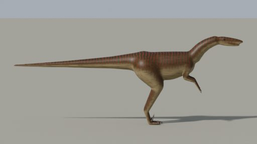 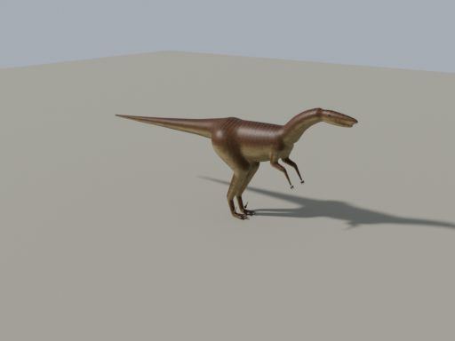

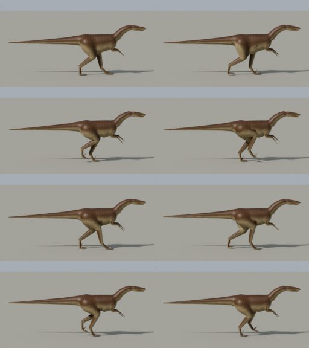

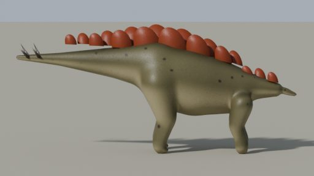 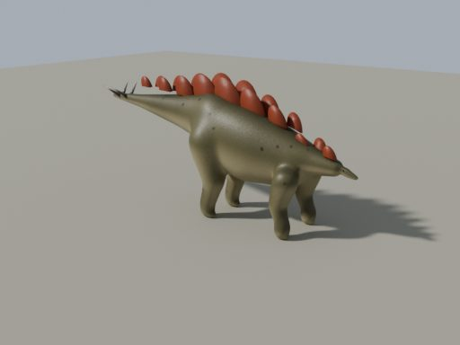

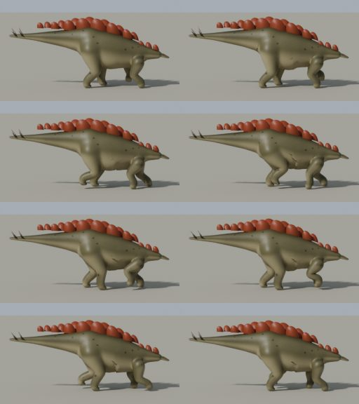

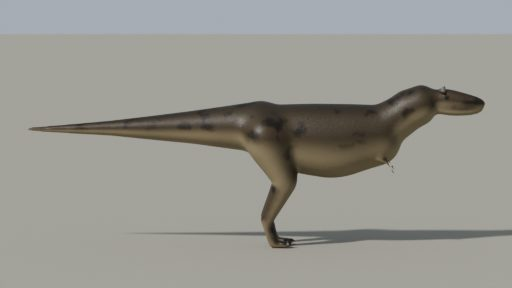 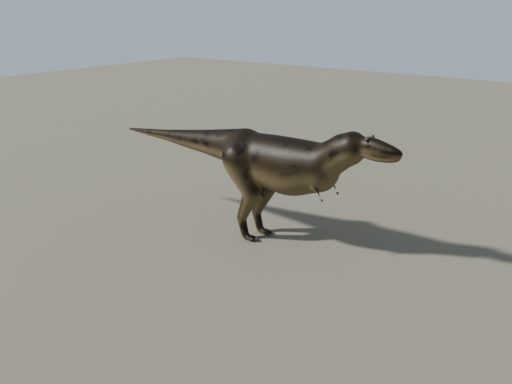

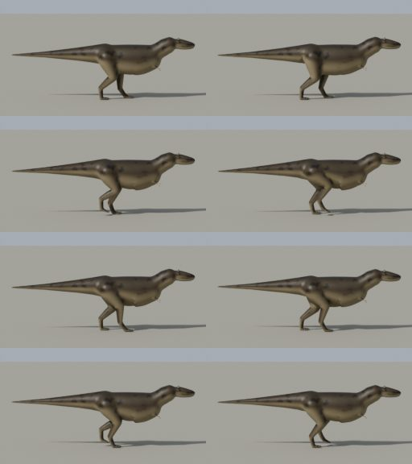

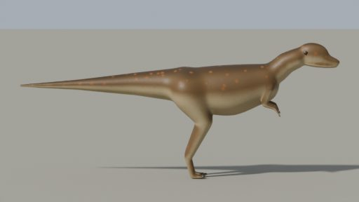 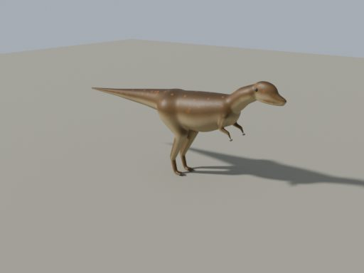

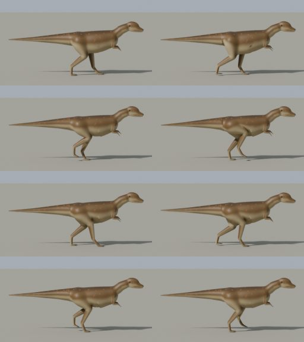

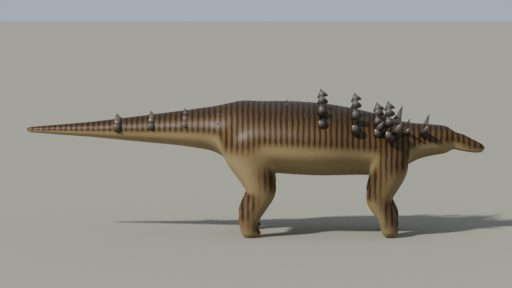 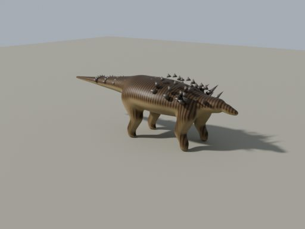

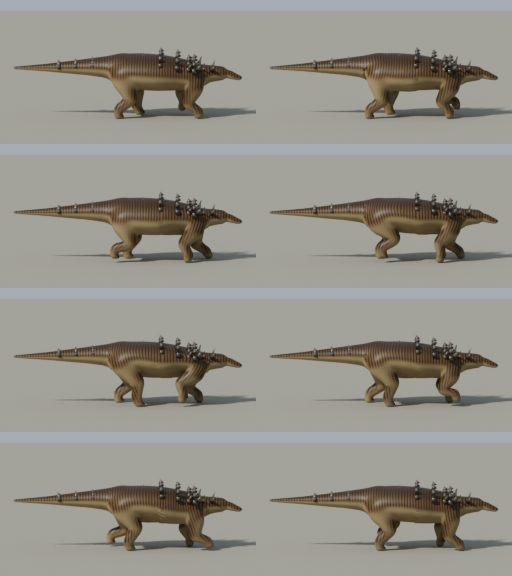

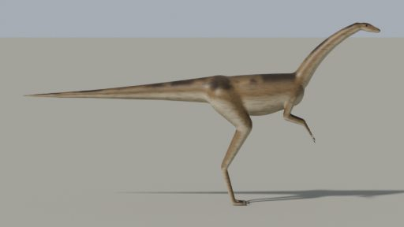 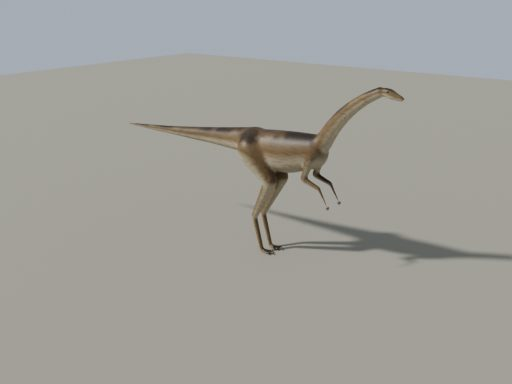

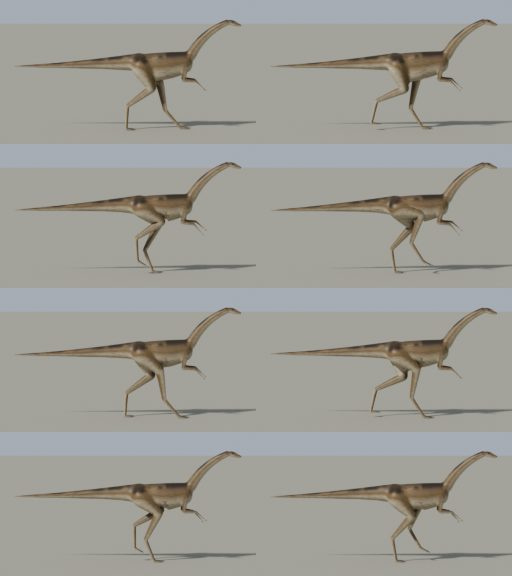

