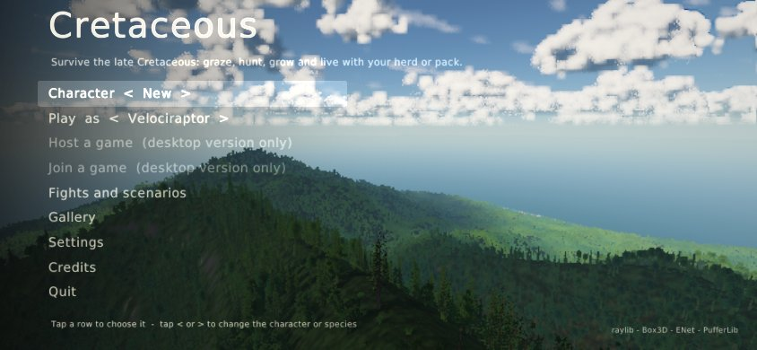
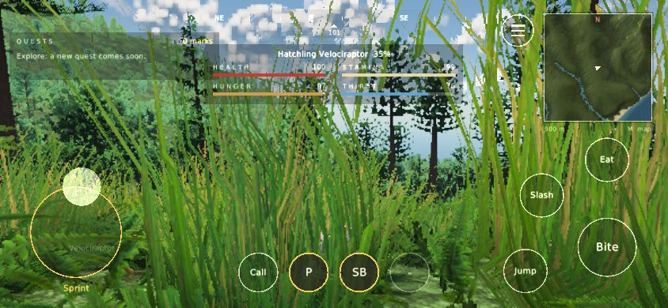

# Web build on phones and tablets

The web build (README, "Web build") also runs on phones and tablets: touch
controls drawn by the game, a page that behaves like an app, and a
small-memory profile for mobile GPUs. This page covers what it does, what it
measures, and what full world streaming would take.




The screenshots come from `tools/web_smoke.js --phone` (headless Chromium,
software WebGL, placeholder capsules for the dinosaurs).

## Touch controls (`touch.h`, `touch.c`)

They are drawn with raylib over the HUD at the HUD's scale. Their sizes are
in CSS pixels, so a button is the same physical size on any screen. On a
phone a button is about 9 mm across and the attack about 12 mm; Apple and
Google ask for at least 7 mm. The player's Interface size setting scales
them too. They show once the screen is touched, or at once on a touch-first
page (a coarse pointer and nothing that hovers). They hide when a key is
pressed, the mouse is clicked or the wheel turns, so a laptop with a touch
screen switches back and forth. Mouse motion alone never hides them: raylib
moves the mouse with a single finger, and a resize moves it too.
`CRET_TOUCH=1` shows them always, natively too, for screenshots;
`CRET_TOUCH=0` never.

| Control | Where | What it does |
|---|---|---|
| Stick | Left 45% of the screen, below the top 30%, wherever the thumb lands | Moves relative to the camera. It is analog: a gentle push walks, so you can creep up on prey. Pushed to the rim it sprints, and the ring turns gold with a "Sprint" label |
| Camera | A drag anywhere else | Turns the camera, 0.006 rad per CSS pixel times the sensitivity setting. When no finger is turning it, the camera swings in behind the running animal, as in the mouse drag scheme |
| Bite / Ram / Tail | Bottom-right corner | Primary attack, with its cooldown sweep |
| Slash / Swipe | Up and left of it | Secondary attack (species that have one) |
| Jump | Left of it | Jump (species that can), or "Let go" while latched |
| Eat / Drink | Above it | Hold to eat. It reads "Drink" when water is ahead, as E does |
| Carry / Drop | Left of the right-hand arc, carnivores only, shown when something lies at the mouth or is held | Picks up or puts down food (B) |
| Nest | Above Carry, shown to a fed adult with no nest | Hold to build a nest (N) |
| Call, 1, 2, 3 | Bottom centre, where the ability bar is with a keyboard | Call, and abilities 1-3 with the ability bar's look: initials, a dark cooldown sweep and seconds, a gold ring when ready, blue when short of stamina, a dim "-" while locked |
| Menu | Top right, left of the minimap | The pause menu (Esc) |
| Minimap | Tap it | The island map; any tap closes it |
| Dead | Tap anywhere | Respawn now (Enter) |

Multi-touch: each finger gets one job when it comes down, so the stick and
the camera work together. raylib 5.5's web touch callback drops the last
entry of its list on every touchend. Its list is ordered by touch id, so
when one of two fingers lifts it can keep the lifted finger and lose the one
still down: lifting the camera finger stopped the stick. `touch.c`
therefore checks raylib's list against the page's own record of the fingers
down (`TouchEvent.touches`), and keeps a finger raylib lost at its last
position. A tap shorter than a frame starts and ends between two polls and
never reaches raylib's list. The page queues every touchstart, so such a tap
still presses a button or picks a menu row. That matters at 10 fps on a
weak phone and in the headless test.

HUD under touch (`CretHud.touch`):
- The vitals become a compact strip under the compass: name, stage and four bars in two columns. The stick takes the bottom left.
- The minimap shrinks from 220 to 180 units. The group panel is hidden; the minimap still shows the group.
- The ability bar's slots and attack radials give way to the buttons; status chips move above the food prompt.
- Prompts name buttons instead of keys ("Eat  graze", "push the stick gently"), and the death screen says "tap to respawn now".
- The keyboard help line is hidden.

Menus by tap:
- A tap is a click that also selects its row. This works on the title, settings, scenario and pause menus.
- On the title, tapping the `<` or `>` of the character or species steps it, and a tap elsewhere on the row picks it.
- A new character cannot be named without a keyboard, so it gets the species' name and a number ("Velociraptor2").
- In the pause menu, a tap on the left third of the species or ability-3 row steps the other way.
- The title and settings pages fit a phone held sideways (390 CSS pixels tall). The title closes up its rows; settings moves sound, key bindings and Back into a second column.

## Page (`web/index.html`, `web/loader.js`)

- Viewport: `width=device-width, initial-scale=1, maximum-scale=1, user-scalable=no, viewport-fit=cover`.
- Touch handling: no scrolling, pull-to-refresh, pinch or double-tap zoom, text selection, long-press menu or tap highlight (`touch-action: none`, `overscroll-behavior: none`, `user-select: none`).
- The canvas is sized in CSS pixels, not device pixels: a phone renders a third as many pixels in each direction as its screen has at DPR 3, and the HUD's height-based scale then gives legible text.
- Rotation resizes it: raylib's resize callback sets the canvas to the new window size, and the game resizes its targets (`IsWindowResized`).
- The first tap on a touch device asks for fullscreen and, on Android, a landscape lock. iPhones refuse element fullscreen, and their page stays as it is.
- Held upright, a touch device shows a hint to turn sideways; a tap puts it away.
- The message for a browser without WebGL2 is unchanged.

## Keyboard and mouse (`web/loader.js`)

**Short presses.** raylib's web backend keeps only the current state of each key and mouse button. GLFW's listeners set it as the browser's events arrive. The game asks whether a key went down since the last frame (`IsKeyPressed`, `IsMouseButtonPressed`). A click or a tap of a key that went down and came up again while a frame was being drawn was therefore never seen. A quick click or tap lasts 50 to 100 ms. At 15 fps, menu clicks and Enter on the title did nothing, and at 10 fps most attacks, jumps, B and 1-3 were lost.

The page now holds key and mouse button events back:
- An event goes on to GLFW only once the game has begun a frame since that key or button last changed.
- Until then it waits, in the order it came, and goes on when the next frame begins. The frame count is `Module.cretFrames`, which `cret_web_next_frame` in `cretaceous.c` raises once per frame.
- So every press is down for exactly one frame, however short it was and however slow the frame. A key pressed twice within a frame counts twice, one frame apart.
- A key held longer than a frame changes the moment it does, as before. The one-frame minimum is the only difference.
- While a press waits, the events after it wait too, so presses stay in order. Down, Down, Enter within one frame moves the menu two rows and then picks.
- Key repeats change nothing and pass straight on. A repeat of a key whose press is still waiting is dropped, so it cannot become a second press.
- Characters (typing a name, the console) come through `keypress` and are not held back.

Because raylib's own state is corrected, every reader sees the press: the title, settings, scenario and pause menus (`menu.c`, `hud.c`), play input (`player_input`, which already carries presses to the next 30 Hz tick), the map, the debug console and free cam. None of them changed. The native build has no such page and is unchanged.

**Focus.** The first click or touch on the canvas gives it keyboard focus. Keys reach the game wherever focus is on the page; inside an iframe (a claude.ai Artifact), the click is what brings the keys to the page at all.

**Leaving the page.** On alt-tab or a tab switch, every key and mouse button still down is let go, and presses still waiting are dropped. GLFW used to let go of the keys itself, but never of the mouse buttons, so a button held while switching away stayed down. A button let go off the canvas is released too, for example after dragging out of a window that is not fullscreen. The page now does all of these releases through the same queue, so a press passed on just before still gets its frame.

**Esc in pointer lock.** Play locks the pointer (mouse look). Desktop browsers keep the Esc that ends a pointer lock for themselves and do not pass it to the page, so it took a second Esc to open the menu. Now, when the lock ends without the game asking, the page passes on one Esc press, and the menu opens as the README says. This covers Esc and also switching away. When the game lets go of the lock itself (the menus, Tab), nothing is sent. Headless Chromium does deliver that Esc, and so may some browsers. An Esc the browser delivers within half a second of the lock ending is not counted again. After Resume, the next click takes the lock again. Browsers refuse a new lock for about a second after the user ended one.

Measured with `tools/web_smoke.js --short-press` (headless Chromium, SwiftShader, every press 10-30 ms long):

| | Presses lost (title / play) |
|---|---|
| 5.0 | MEASURE |
| Now | 0 of 8 / 0 of 12 |

## Small-memory profile

Phones have no S3TC (BC3), so every game texture stays RGBA8 there: four times the memory of the desktop's BC3.
- **Who gets it.** The loader turns the profile on when the page is touch-first or the GPU lacks `WEBGL_compressed_texture_s3tc` (and its sRGB variant), or with `?mobile`. A desktop is unchanged.
- **What it sets.** Ground materials, props and dinosaurs at 512 texels (`CRET_MAT_SIZE`, `CRET_PROP_TEX`, `CRET_DINO_TEX`), the plant atlas at 256 (`CRET_VEG_ATLAS`, new) and tree impostors at 128 (`CRET_VEG_IMP`, new).
- **Why that loses nothing.** A phone held sideways shows the 3D view at about 590 x 273 pixels at the low preset's render scale of 0.7, so none of this is visible.
- **Atlas.** The atlas is still painted at 512 and uploaded from its 256 mip down. Its cache key changes only when it is capped.
- **Preset.** The low preset is the web default (render scale 0.7, three 1024² shadow cascades to 240 m, plant ranges at 0.6, props at 0.5, a third of the cloud steps).
- **Checked natively** (`CRET_PRESET=low` against high, `CRET_VEG_DEBUG=1`, 844x390): shadows drop from 4 cascades at 2048² to 800 m to 3 at 1024² to 240 m. Trees drop from 1.10M to 0.52M triangles, ground plants from 511k to 151k, and sward tufts from 16k to 10k.
- **Knob order.** The pack's knobs come first, then the profile, then `?env=`, which now wins over both (before, the pack's `CRET_MAT_SIZE` overrode `?env=`).

ETC2 (`WEBGL_compressed_texture_etc`, common on mobile WebGL2) is not used.
`render/texbuild.c` would need an ETC2 RGBA encoder (EAC alpha plus the
ETC1/T/H/planar colour modes) with a decoder for its tests. That is a few
hundred lines, and on a phone it would run single-threaded in wasm on every
first visit. With the profile's sizes, the textures ETC2 could compress are
small: ground materials 11 MB, plant atlas 11 MB, impostors 25 MB. What is
left of GPU memory is mostly the 2048² terrain textures, which are floats or
need exact values and would not be block-compressed anyway. So it is RGBA8
at reduced sizes.

## Memory

Measured by `tools/web_smoke.js` in headless Chromium on SwiftShader. The
wasm heap is the size of its buffer: it only grows, in steps, so the
allocator's figures are given too (in use now, and the arena, its high-water
mark). Files are the in-memory file system. GPU is an estimate: every texture
level and renderbuffer the page allocates, counted by wrapping WebGL.
Processes are the resident sizes of Chromium's renderer and GPU processes.
SwiftShader keeps the GPU's memory in the GPU process.

| Phone (390x844 at DPR 3, held sideways, no S3TC) | Wasm heap | malloc in use / peak | Files | JS heap | GPU estimate | Renderer | GPU process |
|---|---|---|---|---|---|---|---|
| 5.0, title | 531 MB | not reported | 485 MB | 497 MB | 403 MB | 1188 MB | 742 MB |
| Now, title | 443 MB | 188 / 352 MB | 72 MB | 78 MB | 231 MB | 696 MB | 511 MB |
| Now, play | 443 MB | 194 / 352 MB | 72 MB | 78 MB | 235 MB | 699 MB | 523 MB |

The 5.0 row is the 5.0 build under the same emulation. It cannot get past
the title there: it has no touch input.

| Desktop (960x540, S3TC) | Wasm heap | malloc in use / peak | Files | JS heap | GPU estimate |
|---|---|---|---|---|---|
| Now, title | 443 MB | 187 / 396 MB | 105 MB | 117 MB | 342 MB |
| Now, play | 443 MB | 192 / 396 MB | 39 MB | 117 MB | 346 MB |

What changed:
- **The island's file.** It is deleted from the in-memory file system once loaded (`world.c`): 185 MB. The loader also stops holding the inflated bundles, and gives the smaller files of a bundle their own copies, so the island's buffer can actually go. The world then stays loaded for the whole visit, so a scenario after the title does not need the file again.
- **Bake-only fields.** Rain, soil and temperature are skipped when the browser loads the island (`terra.c`; `web_pack.py` already shipped them zeroed): 48 MB of the wasm heap.
- **Terrain cache items.** On web they are no longer written to the in-memory file system (`render/cache.c`). The page never kept them, and they held about 130 MB until it deleted them.
- **The profile above.** Impostors went from 100 MB to 25 MB and the plant atlas from 44 MB to 11 MB.

What is left (phone, title):
- **wasm heap.** malloc has 188 MB in use, 172 MB of it the world. That is the runtime fields at 32 bytes a sample (134 MB), the B-spline height coefficients (17 MB) and Box3D's heightfield (21 MB). The heap stays at 443 MB because loading peaks at a 352 MB arena (terrain derivation temporaries next to the world), and a wasm heap never shrinks.
- **GPU.** The nine 2048² terrain textures (about 150 MB), impostors (25 MB), the three 1024² shadow cascades (12 MB) and the render targets.
- **Files.** The texture cache items until the page has saved them to browser storage, then the assets and the cloud volumes (about 40 MB).

That totals about 0.7 GB of page memory plus about 0.25 GB of GPU memory.
It is within what recent phones give a tab (roughly 1 to 1.5 GB on iPhones
and Android phones with 4 GB or more). On a 3 GB phone it is tight. The
next cheap win there is the load peak: building the terrain textures in
bands would cap the arena near the steady 190 MB, and the heap near 250 MB.

## World streaming: what it would take

Not built. The 2048² island (4 m cells, 8.2 km across) is held whole, 172 MB
at runtime on web. The derived terrain textures add about 150 MB of GPU
memory.

Runtime fields per sample: height, water and flow (floats), water kind,
flow direction (2 bytes), splat weights (8), vegetation weights (8) and
hardness. That is 32 bytes, plus 4 for the B-spline coefficients and about 5
for Box3D's heightfield.

What reads the world directly:
- Most code goes through `cret_height` and `cret_water` (B-spline coefficients and the water field).
- Some code indexes `CretWorld.map` arrays itself:
  - `sim.c` and `critters.c`: food from vegetation, water kind.
  - `progress.c`: quest places, a scan of the whole map once per world.
  - `scenario.c`.
  - `audio.c`: ambience from water kind, splat and vegetation near the listener.
  - `hud.c`: the minimap, built from the whole map on first draw.
  - `cretaceous.c` and `capture.c`: review shots and the title flyover scan the map.
  - `render/view.c`: the nine whole-island terrain textures and the horizon bake.
  - `render/veg.c` and `render/veg_place.h`: scatter rings round the camera.
  - `render/props_place.c`: prop tiles.
  - `render/dino.c`: feet on the ground.
  - `world.c`: the Box3D heightfield over the whole island.

A plan, in order:
1. **Chunks.** `web_pack.py` writes the runtime fields in 256² chunks (1 km, about 9 MB each before compression), plus a quarter-resolution overview (512²: height, water, splats; about 3 MB). The loader keeps the chunks gzipped in memory (29 MB for the island) or fetches them on demand, and inflates them when the game asks.
2. **Accessors.** Every direct `map.field[i]` read goes through accessors that find a sample's chunk in a 8 x 8 table and load it if missing. The sim must read full-resolution data wherever an agent is, so the resident set is the union of a window round every agent (5 x 5 chunks round the player is 25 chunks, about 60 MB with coefficients and collision). The population director already spawns and retires animals round the player. The RL environment, the server and native play keep everything resident: streaming is a web-only policy behind the accessors, and results stay identical.
3. **Collision.** One Box3D heightfield per chunk, created and destroyed with residency, as `CretPropStream` already does for prop tiles.
4. **Terrain rendering.** The nine whole-island textures become a clipmap: a 1024² window at full resolution round the camera, updated in strips with `texSubImage` as it moves, over the overview for the distance. The horizon bake runs per chunk in the packer, and its results ship.
5. **Whole-map scans** (quest places, minimap, flyover shots) move to the packer or read the overview.

Items 1-3 take the world from 172 MB to about 65 MB. Item 4 takes the
terrain textures from 150 MB of GPU memory to about 40 MB, and it is the
largest piece of work.

## Checking it

```bash
node ocean/cretaceous/tools/web_smoke.js --phone     # phone held sideways: taps, stick and camera together, rotation, menu by tap; memory (about 15 min)
```

```bash
node ocean/cretaceous/tools/web_smoke.js             # desktop: keyboard into play; memory and frame time (about 15 min)
```

```bash
node ocean/cretaceous/tools/web_smoke.js --short-press   # desktop: every click and key 10-30 ms long, on the title and in play (about 20 min)
```

```bash
CRET_TOUCH=1 ./build/cretaceous/cretaceous play --size 844 390   # the touch layout natively, at phone size
```

What `--phone` does:
- Emulates Chromium's mobile mode (touch, DPR 3, coarse pointer) with S3TC hidden, as on a phone's GPU.
- Taps Play on the title with a tap shorter than a frame.
- Holds the stick pushed to sprint while a second finger turns the camera, lifts the camera finger first, and checks that the animal kept moving.
- Turns the window upright and back, checks the canvas size and that the controls still show.
- Opens the menu with its button and resumes by tapping Resume.

It saves `phone_title.png`, `phone_play.png`, `phone_move.png`, `phone_upright.png`, `phone_menu.png` and `phone_resumed.png`.

What `--short-press` does:
- Sends every click and key as a down and an up 10-30 ms apart, each after a pause of up to a frame, so most fall inside one frame and some share one. A SwiftShader frame takes seconds, far slower than 10 fps, so nothing is throttled.
- On the title it clicks Settings, presses Esc back, Up five times to Play, then Enter. Play starts only if all of them counted, in order.
- In play it sends left and right clicks, Space (twice within a frame too), B, 1-3, E, G and Q. It holds W for three frames with key repeats, and holds W and the left button while the window loses focus.
- It presses Esc to the menu and back. It then ends the pointer lock as a browser does on Esc three ways: alone, with the browser also delivering that Esc, and with the page losing focus at the same moment.
- `touch.c` records the keys and buttons raylib reports down or up in each frame (`Module.cretInput`). The test fails unless every press was down for exactly one frame, in the order sent, and nothing stayed down.

It saves `web_title.png` and `short_play.png`.
