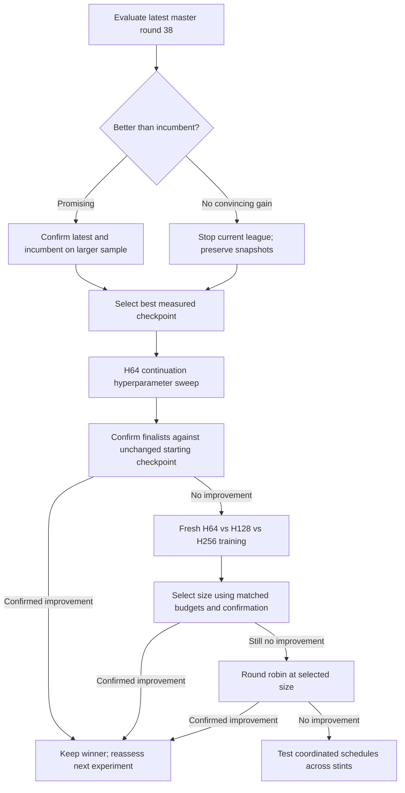

# Pokémon experiment decisions — October 18, 2026

> Historical decision record. The continuation sweep described below is stopped.
> As of October 19 the live job is a fresh 14-member 256x2 round-robin league.
> See [the current handoff and actual experiment DAG](../HANDOFF.md) for current
> execution, results, Vast installation, and recovery instructions. Historical
> “current” paragraphs below describe their original checkpoint in time.

## Current execution update: repaired sweep

Latest user budget: **500 trials**, first trial about **100M** counted steps,
search **50,000,000–500,000,000** steps. This supersedes the earlier 100M–400M
range below. Active Vast tmux window: **`pokemon:sweep`**. Experiment directory:
`reports/pokemon_experiments/20261018_continue_r26_500_v2`; live log:
`build/pokemon/continue-r26-500-v2-20261018.log`.

The previous sweep completed trial zero (100,663,296 counted steps), Oak argmax
0.747395813, before 32 invalid layouts exhausted its failure budget. Its
checkpoints, scores and history remain in `20261018_continue_r26_500`; the new
search has its own history because the space changed. The old result is not a
confirmed gain over the 128-game/team incumbent measurement.

Cause: continuous expert fractions produced learner-agent counts not divisible
by sampled minibatch sequence counts. The local trainer assertion is absent
from our checked-out `upstream/5c`; its bounds requirement is real because the
training loop takes contiguous slices. Retained the guard and repaired the
configuration: expert fraction has step 0.25 (25/50/75%); minibatches range
1024–8192, agents 4096–16384, horizon 16–128, all powers of two. All 144
combinations were exhaustively checked for exact division and sufficient
environments for 13 opponents. Other search dimensions and LR annealing remain
enabled as previously specified. No trainer binary change.

Closed 18 obsolete Pokémon windows after checking dead/idle state and archiving
scrollback under `tmux_archive/`. Only `pokemon:sweep` remains in that session;
the separate `ssh_tmux` session remains. Training output is now displayed in the
pane and saved via tee. Verified the replacement advancing beyond 2.6M steps.

## Objective and current evidence

Optimize fixed-master-team **Oak argmax score**, `(wins + 0.5 * draws) / games`,
averaged equally over the existing three-team panel. Oak retains its full-state
information advantage; search budget stays 4096. This is the user's current
optimization target, superseding the earlier proposal to sweep on a fair bot.
Keep Metamon as a separate external check, not an interchangeable score.

Best measured Oak master: round 26, 286W/0D/98L, **74.4792%** over 384 games.
Checkpoint SHA-256: `440b4dd80bebcc01fc491fdd6b1b9bed046953936e7d597c2207f2b0a6335b40`.
Its completed Vast TaurosV0 evaluation: **47.65625%**, 183W/0D/201L, 384 games,
1539.95 seconds, no timeouts. Team rates: zam_egg_mie 46.875%, jynx_mie_don
37.5%, gar_egg_zap 58.59375%. Both use private observations in that separate
native adapter; this is not a Showdown ladder rating.

At this check-in: 37 complete league rounds, round 38 in progress (6/14 members
published). Master round 38 exists. Latest previous Oak measurement was round 31.
Master round 38 completed on Vast at 128 games/team/mode, seed 20261015,
budget 4096: argmax **14.9740%** (57W/1D/326L); sampled **3.6458%**
(14W/0D/370L). The league was sent SIGTERM through its controller as requested;
completed snapshots are retained. No claim about unmeasured intermediate rounds.

## Decision DAG

Each node is a separate experiment. Preserve the best checkpoint even if later
training gets worse. A failed experiment does not replace the incumbent.
The later capacity, round-robin and coordinated-schedule branches are recorded
plans, not authorization to launch them all unattended now.

## Next sweep: continuation, explicitly confirmed by user

Every trial starts independently from the **same selected saved checkpoint**,
with fresh optimizer state, rather than chaining trials or starting random.
Keep H64/L2 and BF16 training; freeze the selected checkpoint's training opponent
manifest and exact team/rules. Do not let a live roster change between trials.
Use a new history/output namespace: old from-scratch scores do not belong in
this continuation sweep's observations.

Selected start is round 26. Reuse its original frozen 13-opponent manifest
(the peers' round-25 snapshots), with 50% current self-play environments.
Exact launcher: `launch_continuation_sweep.sh`. Remote experiment directory:
`reports/pokemon_experiments/20261018_continue_r26_500`. Default `./puffer train`
configuration is not modified by this separate experiment. LR search lower
bound is extended to 0.00001 for fine-tuning; upper bound remains 0.003.

User correction: **500 trials by default for sweeps**, not 32. Start trial zero
at **100,663,296 counted steps** and sweep steps over **100,663,296–402,653,184**.
The earlier 32-trial launch was stopped during baseline evaluation, before any
training trial completed. Its partial baseline files are retained and are not
a complete score. The replacement starts training immediately; the unchanged
incumbent still needs its larger evaluation before finalist selection.

Exact broad search specification: `continuation_sweep.ini`, copied into an
isolated remote experiment working directory. Sweep agents, horizon, minibatch,
LR, entropy coefficient, gamma, GAE lambda, replay ratio, PPO clipping, value
loss/clip, gradient clipping, momentum, LR floor, entropy annealing toggle/floor,
expert fraction, and V-trace toggle/clips. Architecture, BF16, team/rules,
frozen opponent identities and evaluation protocol stay fixed. Expert fraction
varies 0.25–0.75; trial zero starts at 0.5. LR cosine annealing is **always on**;
floor sweeps 0.01–0.5, starting at 0.1. Entropy annealing starts off but is swept.
Hardware worker counts, seeds, reward definition and model size are not swept.

Use **256 games/team/mode** for routine sweep scoring (768 per mode), twice the
previous 128. More games improve precision; changing search budget would change
the opponent. Reevaluate the unchanged incumbent at the new count too.
Confirm only promising finalists at **1024 games/team/mode**, with the incumbent
evaluated under the same protocol and a reserved seed (20261019). The benchmark
notes Oak's internal search RNG; matching outer seeds does not guarantee paired
search trajectories. Reserve the confirmation seed from sweep selection.

Do not declare a winner from a tiny increase on the selection sample. Report
uncertainty, per-team counts and independent confirmation; a tie or inconclusive
result keeps the incumbent. Larger game counts reduce evaluation noise, not
training-seed variance. Replicate promising training settings before broad claims.

## Later capacity and training branches

Update2026-10-18: user chose fresh H1024 L2 directly, training against eight good
frozen H64 L2 policies for initial1B / swept500M–2B total agent steps. Metamon
24-game score ranks trials. See `../20261018_capacity1024/NOTES.md`. This supersedes
the suggested first capacity grid below; it does not isolate size causally.

Capacity test: fresh H64/H128/H256 with the same frozen opponents, teams,
training steps and evaluation protocol; record wall time as well. H64 control
is necessary because fresh H256 versus a heavily pretrained H64 is confounded.
Existing H64 weights cannot simply load into a wider model. Approximate padded
stored weight counts: 204,576 / 372,256 / 904,224; shared feature encoders remain
fixed width. Retune promising sizes before concluding that size cannot help.

After choosing size, continue compatible checkpoints when appropriate; restart
only for incompatible architecture or an explicitly fresh control. Then test
round robin as its own change, keeping the incumbent for comparison.

Coordinated scheduling is deferred until that branch. Current trainer already
does cosine LR decay within each stint; loading weights for a new stint resets
optimizer and schedule. Hypothesis: repeated schedule resets may impede progress.
This is not established by the current scores.

Candidate global schedule, with cumulative learner progress `s` and planned
budget `S`: `lr(s) = lr_min + 0.5*(lr_max-lr_min)*(1+cos(pi*min(s/S,1)))`.
Track progress per member, not wall time or another member's training. Manual
constant-per-stint values can approximate this curve; disable the inner cosine
when using that approximation to avoid applying two schedules. Smaller stints
give a closer approximation but change other training dynamics. Test schedule
continuity separately from optimizer-state continuity or simultaneous training.
No joint-training/minibatch architecture research or implementation yet.
