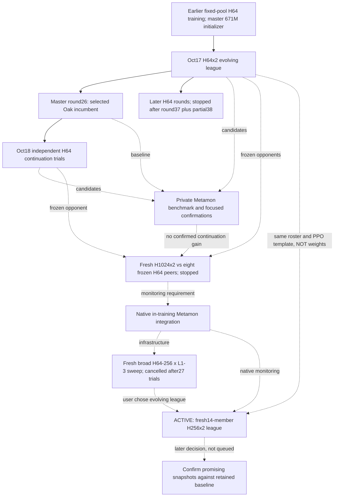

# Pokémon training handoff

Status verified **2026-10-19 21:57 UTC / 17:57 EDT**. This is the current
entrypoint; dated experiment notes are historical and can describe jobs that
have since stopped. Recheck live state before acting. This handoff changed
documentation only, not training, evaluation queues, binaries, or settings.

## TL;DR

- We are training Gen1 Pokémon policies in PufferLib's native engine on Vast.
  Current experiment: **14 fresh 256-hidden, 2-layer BF16 recurrent policies**,
  sequential evolving round robin, **50,331,648 counted steps/member/round**,
  **50 rounds total**. This is not a sweep and is not a continuation of H64 weights.
- Half the environments are current-policy self-play; half face the other 13
  members. Peers freeze during a stint; the new member is published immediately
  for the next member to face. All 14 train, including master.
- Same October 17 PPO/team settings except larger architecture, fresh starts,
  and LR now falls across 50 rounds from **0.0005 to 0.00005**. Optimizer/RNN state
  still resets between stints. We did not implement simultaneous training.
- Only master gets native Metamon monitoring: six games every approximately 10%
  of a stint, **72 games at its end**. Specialists skip this intentionally.
  Oak is off. No extra tournament, old search, or confirmation queue is running.
- At the check: **6 full rounds complete; round 7, 11/14 published**, with
  `gar_egg_mie` training at about 30.4M/50.3M, 252K counted steps/sec. Master's
  round 7 is already complete: **34W/1D/37L, 47.92%**. Best final so far is
  round 6: **36W/1D/35L, 50.69%**. This does not establish a gain over the old
  47.17%/300-game baseline; 72 games and best-of-round selection are noisy.
- Vast instance/container ID **56007315**, SSH **root@ssh6.vast.ai:33431**,
  checkout **`/workspace/PufferLib`**, tmux **`pokemon:rr256`**, pane **`%29`**.
  Local checkout: **`/home/felix/puffertank/pufferlib`**.
- **Do not run ordinary `./puffer sweep` to resume this league.** Its default
  config still describes the cancelled broad sweep. Use the league launcher below.
- **Storage warning:** about 9.4 GiB free on a 32 GiB container filesystem;
  `/workspace` is **not** volume-backed. Stop/start preserves files, but
  recycle/destroy wipes them. No full off-box checkpoint backup was made by this
  handoff. Preserve data before destroying the instance.

## What we are trying to learn

The practical goal is stronger learned play against an external opponent, not
just higher self-play win rate. Older work optimized Oak argmax scores; current
feedback uses the released Metamon TaurosV0 through our private-information
native adapter. We tried H64 continuation, then larger fresh models/frozen
opponents, then a broad native sweep. The user cancelled that sweep and chose
larger evolving round training with round-spanning LR decay.

This current run combines changes; it is not a controlled size-only or LR-only
ablation. Preserve old baselines and do not attribute any gain to one change.

## Experiment DAG and disposition

Solid arrows below mean **learner weight ancestry**. Dotted arrows are
experiment decisions, infrastructure reuse, or frozen opponents, not warm starts.



| Experiment / location under `reports/pokemon_experiments/` | Status and evidence |
| --- | --- |
| `20261017_roundrobin_50m` | H64x2 league stopped; 37 full rounds plus partial 38. League data in `leagues/pokemon/rr50m_bf16_20261017`. Best measured Oak master r26: 286W/0D/98L, 74.48%/384. Later r38 Oak fell to 14.97%/384 argmax. Do not infer all intermediate rounds were measured. |
| `20261018_continue_r26` | Superseded short launch; stopped during baseline work. Not a completed comparison. |
| `20261018_continue_r26_500` | First 500-trial version; one training result then invalid sampled minibatch layouts exhausted failure budget. Retained, superseded. |
| `20261018_continue_r26_500_v2` | Layout-repaired continuation sweep stopped at user's request after 73 completed trials. Each started independently from r26 with fresh optimizer and the frozen r25 peer bank. Best Oak trial50: 74.6745%, not a confirmed improvement. |
| Old league `evaluations/metamon-policy-search` | Broad 559-candidate search stopped after 41 screens; replaced by focused comparison. Not running, not an exhaustive ranking. |
| Old league `evaluations/metamon-leaders-20` and `metamon-finalists-100` | Focused 20-policy comparison and independent 300-game finalist follow-up completed. Baseline r26 47.17%; sweep50 46.67%; sweep49 43.33%; sweep39 41.00%. No confirmed improvement. |
| `20261018_capacity1024` | Fresh H1024x2 learner, eight frozen H64x2 opponents, initial 1B then 500M–2B search range. First final 11W/0D/13L = 45.83%/24; later training stopped. No H64-to-H1024 weight resizing. Historic viewer/worker notes do not describe an active job now. |
| `20261019_native_metamon` | Infrastructure branch: native dashboard/evaluator lifecycle, periodic checks without resetting optimizer within a stint. Replaced external worker/viewer dependence for new native runs. |
| `20261019_broad256` | Fresh native sweep across width64/128/256, layers1/2/3, 25M–500M steps and PPO settings. Cancelled during trial28 after27 completed/zero failures. Best final run7: H64x3, about27M steps, 27W/0D/45L = 37.5%/72. Saved weights/history retained. |
| `20261019_roundrobin256_50m` | **Only live training experiment.** Fresh H256x2 evolving league, 50-round target, continuous LR endpoints; settings/results below. |

Historical decision gates are preserved in
[`20261017_roundrobin_50m/EXPERIMENT_DAG.md`](20261017_roundrobin_50m/EXPERIMENT_DAG.md).
The actual sequence above supersedes its old “current execution” paragraphs.
Sweeps defaulted to 500 trials when requested, but cancelled experiments are not
authorized to restart automatically. The active league has a 50-round budget,
not a 500-trial budget.

## Current run: exact configuration and results

Authoritative setup snapshots:
[`experiment.json`](20261019_roundrobin256_50m/experiment.json),
[`roster.json`](20261019_roundrobin256_50m/roster.json),
[`setup.mjs`](20261019_roundrobin256_50m/setup.mjs), and
[`NOTES.md`](20261019_roundrobin256_50m/NOTES.md).
Live `state.json` and each checkpoint's adjacent `config.ini` are authoritative
for actual progress/effective settings; `state_after_start.json` is historical.

| Setting | Value / meaning |
| --- | --- |
| Architecture / precision | H256, 2 recurrent layers; 904,224 stored FP32 weights; BF16 compute |
| Budget | 50,331,648 counted steps per member stint; 704,643,072/full round; 35,232,153,600/50 rounds |
| Counted vs learner steps | Counted includes both player slots. With half expert environments, learner slots are75%: 37,748,736/member stint, 26,424,115,200 planned total learner steps |
| Rollouts | 16,384 agents, horizon32, 96 rollouts/stint; one synchronous buffer, four CPU workers, minibatch8192 |
| PPO | replay3.71047497; gamma0.999899983; lambda0.899999976; clip0.12561436; value coefficient0.52888006; value clip0.2; max-grad-norm0.338345766; momentum0.95 |
| Exploration/rewards | entropy0.020000007, no entropy annealing; terminal rewards; HP/KO shaping, personality/behavior shaping, forced cores, snapshot resets, V-trace all off |
| Initialization | 14 independent fresh policies, seed base73; random weights serialized using a tiny zero-LR pass; benchmarks disabled during initialization |
| Continuation | Weights only between stints; optimizer and recurrent/rollout state restart. Recurrent state carries between horizons within each stint |
| Peer selection | Half current self-play / half frozen-per-stint evolving peers; all other13 members, sequential immediate publication |

Order: `master`, `zam_egg_mie`, `zam_egg_zap`, `zam_egg_gar`,
`zam_egg_cloy_don`, `mie_egg_don`, `mie_egg_zap`, `mie_egg_cloy`,
`jynx_mie_don`, `jynx_egg_zap`, `jynx_egg_gar_zap`, `gar_egg_mie`,
`gar_egg_zap`, `gar_egg_mie_zap`. Exact species/lead bindings are in the roster.

Master uses fixed catalog sets `421,366,389,395,512,445`, Starmie lead121:
Starmie / Exeggutor / Rhydon / Chansey / Snorlax / Tauros. The other members
retain species constraints rather than the master's fixed catalog movesets.

### Round-spanning LR

Boundary multiplier at round r is
`f(r) = 0.1 + 0.9 * (1 + cos(pi * min(r/50, 1))) / 2`.
For round r, the native cosine goes from `0.0005*f(r-1)` to `0.0005*f(r)`.
The scheduler sets the stint's LR and its terminal ratio accordingly; it does
not compound the previous round's already-decayed LR. Round7 runs from
0.0004841997093 to 0.0004785860868. End of round50 is0.00005.

This is a continuous monotone sequence of cosine segments, not exactly a single
global cosine at every step. Plans persist their effective values; retry/resume
does not restart the high LR. Beyond50 the floor holds, though the launcher stops
at50 completed rounds. Optimizer continuity remains unimplemented.

### Completed master final evaluations

All rows use72 games, seed20261025, argmax learner vs sampled TaurosV0;
score is `(wins + 0.5*draws)/games`, **not strictly win percentage when draws occur**.

| Master round | W / D / L | Score |
| --- | --- | --- |
| 1 | 6 / 0 / 66 | 8.33% |
| 2 | 9 / 0 / 63 | 12.50% |
| 3 | 28 / 0 / 44 | 38.89% |
| 4 | 31 / 0 / 41 | 43.06% |
| 5 | 25 / 0 / 47 | 34.72% |
| 6 | 36 / 1 / 35 | **50.69% best final** |
| 7 | 34 / 1 / 37 | **47.92% latest final** |

Master has completed352,321,536 counted steps /264,241,152 learner-slot steps.
Six-game interim peaks (including66.67%) are not comparable to these finals.
No independent confirmation of this league is scheduled.

## Installed layout and software

Read **`/etc/vast-agents-guide.md`** on connection before operating the instance;
`/workspace/AGENTS.md` links to it. It is a container, not a full VM. Do not
upgrade the host-injected NVIDIA driver or expose new public services for status.

Paths below are relative to `/workspace/PufferLib` unless absolute:

| Component | Location |
| --- | --- |
| Active league | `leagues/pokemon/rr50m_256x2_20261019/` |
| Progress / scheduler owner | Active league `state.json` / `.lock` |
| Frozen training executable | Active league `bin/puffer` |
| Published weights + matching config | Active league `members/<name>/r00000N-a001/{weights.bin,config.ini}` |
| Frozen per-stint opponent manifests | Active league `rounds/r00000N/<name>-opponents.ini` plus `.opponents` |
| Native checkpoints / final evals | Active league `work/checkpoints/pokemon/r00000N-<name>-a001/` |
| Master final filename | `0000000050331648.bin`; report at `0000000050331648.bin.metamon/summary.json` |
| Native eval records | Each `.bin.metamon/` has summary/game/progress/result artifacts; sibling `.bin.metamon.log` has evaluator output |
| PTY training logs | Active league `logs/r00000N-<name>-a001.log` (includes actual command and ANSI dashboard redraws) |
| Native structured logs | Active league `work/logs/` |
| Current setup/launcher/docs | `reports/pokemon_experiments/20261019_roundrobin256_50m/` |
| Previous H64 league | `leagues/pokemon/rr50m_bf16_20261017/` (preserve) |
| Old frozen policies | `saved/pokemon/starmie_sweep/`; additional capacity pool provenance in its `pool_manifest.json` |
| Native league scheduler | `ocean/pokemon/freeleague.mjs`; wrapper `ocean/pokemon/league.sh` |
| Native Metamon hook | `ocean/pokemon/metamon_eval.h`, integrated in `src/pufferl.cu`; sweep integration `src/protein.cu` / `ocean/pokemon/sweep_eval.h` |
| Evaluation bridge/runner | `ocean/pokemon/benchmarks/{private_adapter.c,private_view.py,metamon_opponent.py,evaluate_private.py}` |
| Compiled private adapter | `build/pokemon/private_adapter.so` linked to `build/pokemon/libpokemon.a` |
| Metamon upstream checkout | `build/pokemon/metamon-eval/` |
| Active CUDA evaluation Python | `build/pokemon/metamon-eval-env-cu128/bin/python` |
| Model cache | `build/pokemon/metamon-cache/` (`METAMON_CACHE_DIR`) |
| Older CPU eval env / Oak env | `build/pokemon/metamon-eval-env/`, `build/pokemon/oak-benchmark-env/`; not active training environments |
| Old viewer/external sweep worker | `ocean/pokemon/benchmarks/{watch_sweep.py,sweep_metamon.py}`; historical capacity workflow, not used by current league |

GPU: RTX5060Ti,16,311MiB reported; active trainer about3,788MiB, about250K
counted steps/sec, finite losses. One specialist stint takes about3m20s;
master adds evaluation pauses. Full rounds have been roughly55min; extrapolation
is not a completion guarantee. Scheduler PID at check810708, current trainer
PID883459; **PIDs are ephemeral, rediscover before signaling**.

Verified software: Node v24.20.0 via `/opt/nvm/nvm.sh`; evaluation Python3.12.3,
PyTorch2.8.0+cu128; system nvcc13.2.86. RTX50-series needs a compatible CUDA
wheel (the installed cu128 works); do not substitute the old cu124 environment.
Native training is C/CUDA, not Python/Torch training.

Remote git HEAD: `2da2b31594e819d53633d7776e07cd7949ffccf1`, **dirty tree**.
This commit alone does not reproduce the experiment. Both local and remote trees
contain uncommitted work, including unrelated projects; do not reset or overwrite
them. Preserve modified/untracked source and configs alongside binaries.

Current frozen trainer and root `puffer` SHA256:
`747e2e16d903109da7ef0b480afcc7f9b1bf0d6f7d8fd253715af62f128a0e1a`.
Scheduler SHA256 at handoff:
`ac98d1d3063cf65d35b7d15b62c7fcdd2416c1827bfc9e74b0192602fa0a88b3`.
The older H64/capacity binary hash is
`07849fd021b6534648cdbcddf98375ae855a9e31c12b5f9829c607d0a2f93a78`.
Changes to round LR were scheduler-only: no native rebuild for this league.
The trainer binary is frozen, but scheduler/evaluator files remain shared source;
editing them can affect future stints/evaluations. A binary hash alone is not a
complete reproducibility record. Checkpoint reports retain source/config hashes.

## Benchmark interpretation and qualification

Metamon is **TaurosV0 checkpoint62**, upstream revision
`0a00a759c9a4382a2877088d828302ec294a05a5` (Metamon1.6.0), model SHA256
`3f55b698bd19f189a465797c7bd1fe49c75884de701ab91ad156e6bac70b8ba1`.
Protocol `native-private-v1`: both players get player-information observations,
our policy argmax, Metamon sampled, alternating seats, three opposing teams
`zam_egg_mie`, `jynx_mie_don`, `gar_egg_zap`. `--games` is **per team**;
2 means6 total,24 means72 total,100 means300 total. Native512-update draw cap.

Native monitoring waits for each evaluator while preserving in-stint optimizer
and RNN state, then resumes training. Final-only scores ranked the cancelled
sweep. Dashboard `Evaluate` timing and self-play `score` are not external Metamon
strength. A missing/failed benchmark is not zero; inspect its error/log/report.

Key limitations: fixed teams, small repeatedly used seed/panel, native HP
quantization, reconstructed public PP/effect ordering, no complete Showdown
event stream, final probabilities conditioned on legal public actions. There
is no silent random fallback. This is not Showdown ladder/Elo or a proof of
native/Showdown equivalence. Oak had full native-state information, unlike the
learner; its scores are a separate asymmetric-information stress test. Never
mix Oak, heuristic, interim Metamon, and final Metamon measurements.

Retained old r26 baseline weights SHA256:
`440b4dd80bebcc01fc491fdd6b1b9bed046953936e7d597c2207f2b0a6335b40`.
Initial Metamon measurement183W/0D/201L =47.65625%/384, seed20261018;
later independent confirmation141W/1D/158L =47.1667%/300, seed20261024.
The current league's50.69%/72 is promising monitoring, not a confirmed win over
that baseline. A rough binomial sampling half-width near50% at72 games is about
12 percentage points, before selection effects or protocol limitations.

Validation already performed (do not rerun GPU tests alongside training just
for a status check): FP32 CPU/GPU encoder parity and172 finite-difference probes;
BF16 H64/H128/H256 forward/gradient checks (largest normalized error0.00257,
tolerance0.025); privacy/action/projection and evaluator lifecycle tests;
native maximum/minimum broad-sweep smoke workflows; all7 league tests on Vast,
including a real two-member two-round native init/train/eval/resume workflow.
These are implementation checks, not proof the encoder is optimal. Move/species
embeddings remain width32 with64-wide intermediate MLPs even at larger recurrent
width; no production encoder change was made for the current run.

## Operator runbook

### Connect and inspect (read-only)

```bash
ssh -p 33431 root@ssh6.vast.ai
cat /etc/vast-agents-guide.md
cd /workspace/PufferLib
. /opt/nvm/nvm.sh
node ocean/pokemon/freeleague.mjs status leagues/pokemon/rr50m_256x2_20261019
tmux list-panes -a -F '#{session_name}:#{window_name} #{pane_id} #{pane_current_command}'
tmux capture-pane -p -t pokemon:rr256 -S -100
df -h /workspace
nvidia-smi
```

Non-interactive SSH must also source nvm before `node`; otherwise `node: command
not found` is a shell setup issue, not a failed league. For interactive viewing,
`tmux attach -t pokemon`; detach with Ctrl-b then d. Do not create extra viewer
windows for ordinary checks. `ssh_tmux` is separate and should be left alone.

Read final-only master scores without launching evaluation:

```bash
cd /workspace/PufferLib
jq -s 'map({checkpoint, games, wins, draws, losses, score})' \
  leagues/pokemon/rr50m_256x2_20261019/work/checkpoints/pokemon/r*-master-a*/0000000050331648.bin.metamon/summary.json
```

Each native step counter restarts per stint. `state.round` means full completed
rounds; `pending.round` and `pending.completed` show partial-round progress.
Master runs first, so its latest round can be ahead of the full-league count.

### Stop only when requested

Attach to the verified training pane and use Ctrl-C. Alternatively, after
verifying the target with `tmux list-panes`, send Ctrl-C to that exact pane:

```bash
tmux send-keys -t pokemon:rr256 C-c
```

Inspect the scheduler PID from `.lock` and `ps -eo pid,ppid,pgid,args --forest`
before/after. The scheduler owns a `script` PTY wrapper which owns the trainer;
native evaluation is a child of the trainer. Verify all relevant children exit
before restarting. If an orphan remains, target only its newly verified PID,
not generic `pkill node`, `pkill python`, or every `puffer` process. Never treat
an old PID copied from this document as safe to signal. Do not stop the Vast
instance merely to stop training. Completed artifacts remain retained.

### Resume the existing league, only after it is stopped

In the existing tmux training pane:

```bash
cd /workspace/PufferLib
. /opt/nvm/nvm.sh
bash reports/pokemon_experiments/20261019_roundrobin256_50m/launch.sh
```

This derives `50 - state.round`, resumes an unfinished round, skips its published
members, and stops at50 completed rounds. Do not pass another unconditional
`--rounds 50`: that would request additional rounds. Do not rerun `setup.mjs`
against the existing league or use `./puffer sweep` as a resume command.

An unfinished member retries from its planned starting weights with a new
attempt suffix; unsaved in-stint progress/optimizer state is not restored from
an arbitrary interim file. Planned LR and peer versions are retained. Never
manually mark an interrupted member complete. Existing attempts are preserved.
The scheduler removes a stale lock only after verifying its same-host owner is
dead. Do not delete a live lock; cross-host migration needs deliberate review.

### Extra evaluation is optional, not running or authorized by a status request

If the user requests confirmation, evaluate retained baseline and candidate on
the same new seed/count/protocol, ideally while training is stopped or after
agreeing on shared-GPU overhead. Example **for later requested use only**:

```bash
cd /workspace/PufferLib
METAMON_CACHE_DIR=/workspace/PufferLib/build/pokemon/metamon-cache \
build/pokemon/metamon-eval-env-cu128/bin/python \
  ocean/pokemon/benchmarks/evaluate_private.py \
  leagues/pokemon/rr50m_256x2_20261019/members/master/r000006-a001/weights.bin \
  --opponent TaurosV0 --mode argmax --device cuda --threads 1 \
  --games 100 --seed 20261026 \
  --output reports/pokemon_experiments/20261019_roundrobin256_50m/confirm-r6-seed20261026
```

That is300 total games, not100. The output directory must be new; retain the
checkpoint's adjacent `config.ini`. Do not move evaluation to local CPU without
asking: the user explicitly wanted these evaluations on Vast. Historical
512-game launcher filenames can contain reduced32-game arguments; read actual
arguments rather than infer budgets from filenames.

### Storage, backup, rebuild, and migration

Scheduler checks a2GiB reserve before initialization/new stints; it stops rather
than deleting data. Native Metamon also checks its reserve. This is not a quota
or a guarantee against another process filling disk mid-stint. Current league
was about1.48GB at the check and grows with every round, including master interim
weights. Monitor free space; do not delete old models to make room without approval.

Before recycle/destroy/migration, copy off-box at least: full active league,
old baseline/finalist weights plus configs, manifests/reports, dirty source and
untracked implementation/tests, frozen binaries, and enough dependency/cache
metadata to rebuild evaluation. Preserve paths or explicitly migrate absolute
paths recorded in state/config/manifests. Verify copy sizes/hashes and inspect
checkpoint/config pairs. Local reports and a few historical backups do **not**
constitute a complete replica of Vast. This handoff only synced documentation.

For future implementation work, build a separate candidate binary, e.g.
`PRECISION= ./build.sh pokemon puffer-pokemon-candidate` (default BF16), qualify
it, then obtain agreement before changing the production experiment. Do not
overwrite the active league's frozen executable. Evaluator setup entrypoint is
`bash ocean/pokemon/benchmarks/setup_private.sh cu128`; it installs an isolated
environment and rebuilds the shared adapter, so it is **not** a harmless status
command and should not be run under live evaluation without planning.

## Next-agent checklist / boundaries

1. Recheck status, final master reports, free disk, and process tree. Leave this
   run alone unless the user asks for a change. Use this document's date as a
   snapshot, not a claim that round7 is still current.
2. Report completed72-game finals separately from noisy six-game interims;
   retain best and latest snapshots, and do not conflate training metrics with
   benchmark strength. Missing specialist scores are intentional, not failures.
3. Watch disk growth. Request a backup/storage decision before space becomes a
   blocker; never silently erase history. No automatic cleanup is configured.
4. If asked to select a winner, propose a matched fresh-seed baseline/candidate
   confirmation; do not silently resurrect the559-policy search or500-trial sweeps.
5. LR continuity is implemented; optimizer continuity and simultaneous/joint
   training are not. Those are separate future experiments, not pending tasks
   authorized by this handoff. No causal architecture claim is established.
6. Preserve unrelated dirty files and old artifacts. No commits, remote pushes,
   training restart, or new experiments were part of this documentation request.
