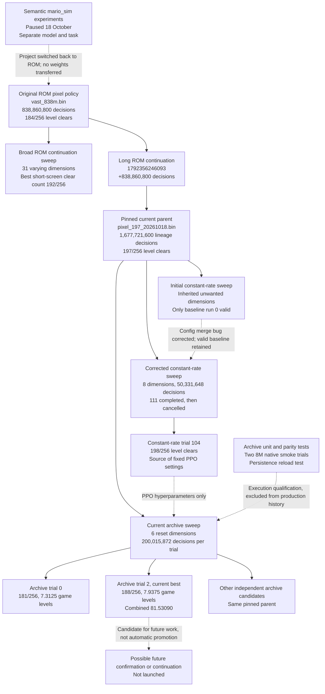

# Retro ROM training handoff

Status checked **2026-10-19T21:55:08.385212+00:00**, approximately **17:55 EDT on 19 October 2026**. This handoff covers the active SMB1 ROM experiment, its predecessor experiments, exact policy ancestry, implementation, deployment, and operating procedures. Numeric results below are a dated snapshot; use the live files for later results.

**Final live refresh, 22:08 UTC / 18:08 EDT:** still 10 completed trials and the same best. Trial 10 advanced to **177,209,344 / 200,015,872 decisions** at approximately **114,575 decisions/s**, with 1,547 cells and phase one. See [handoff_final_check.json](handoff_final_check.json). The detailed snapshot and result table below remain dated 21:55 UTC.

## TLDR

- **Keep the current sweep running.** It is healthy in Vast tmux `ssh_tmux:0.0`: 10 completed trials, no recorded failures, and trial 10 (`sweep_1792446150297_0010`) at **86,507,520 / 200,015,872 decisions**, about **115,680 decisions/s**.
- We are training the original SMB1 World/NTSC ROM through QuickNES, with a full-screen CNN plus RAM features and a recurrent PPO policy. The separate semantic `mario_sim` project is paused.
- The experiment automatically collects real savestates, samples useful or difficult states for fresh episodes, and gradually shifts toward full games. There is no authored sequence of obstacles or mastery gate.
- **Best current candidate is trial 2:** combined score **81.53090**, **188/256** isolated-level clears, **7.9375** mean levels cleared in a full game, **0/16** full-game wins. The unchanged parent scores **79.11417**, **197/256**, **2.0**, and **0/16**, respectively. Five of the best candidate's full-game attempts cleared 15 levels, with no warps recorded. Maximum observed full-game clears remain 15.
- Only one of the first ten candidates beats the parent on the combined objective. Full-game competence improved, but isolated-level forgetting remains. This is not yet a full-game solution or an independently confirmed general improvement.
- Every trial independently loads `saved/retro/pixel_197_20261018.bin`. The old constant-rate winner supplied **PPO settings only**. Current winners are **not** automatically chained into later trials.
- **One active installation:** `ssh -p 25023 root@ssh5.vast.ai`, repository `/workspace/PufferLib`, executable `./puffer`, config `config/retro.ini`. Local mirror: `/home/felix/puffertank/pufferlib`.
- Production uses **200,015,872 decisions per trial**, a **108,000-native-frame episode cap** (about 30 minutes), and a cap of **500 successful trials**. Trials currently take about 30 minutes each. The 30-minute episode cap and 30-minute observed trial runtime are different quantities.
- This check-in did not stop, restart, or change training. A compact portable backup is [handoff_bundle.tar.gz](handoff_bundle.tar.gz); it includes the current best policy and archive, parent, history, settings, and source overlay, without ROM bytes or generated ROM blocks.

## Current results

All production candidates below trained exactly 200,015,872 additional decisions from the same parent. All used the same fixed evaluation protocol. Trial identifiers are zero-based.

| Trial | Combined score | Level clears out of 256 | Full-game wins out of 16 | Mean levels per full game | Wall minutes |
| --- | ---: | ---: | ---: | ---: | ---: |
| Parent | 79.11417 | 197 | 0 | 2.0000 | Not a training trial |
| 0 | 78.17243 | 181 | 0 | 7.3125 | 30.23 |
| 1 | 74.21625 | 172 | 0 | 6.8750 | 30.09 |
| 2 | 81.53090 | 188 | 0 | 7.9375 | 30.09 |
| 3 | 73.25082 | 182 | 0 | 2.0000 | 29.86 |
| 4 | 74.03216 | 184 | 0 | 2.0000 | 29.49 |
| 5 | 72.47040 | 180 | 0 | 2.0000 | 29.79 |
| 6 | 72.58076 | 179 | 0 | 2.5000 | 29.82 |
| 7 | 76.37753 | 190 | 0 | 2.0000 | 29.59 |
| 8 | 75.92030 | 181 | 0 | 5.0625 | 30.06 |
| 9 | 72.85836 | 181 | 0 | 2.0000 | 29.72 |

The current best loses fewer old skills than trial 0, but still trails the parent on the isolated-level panel. Against the parent, trial 2 improves 1-2 from 7/8 to 8/8 and 1-3 from 0/8 to 1/8. It regresses on 2-2, 4-2, 5-1, 5-2, 5-4, 6-1, 7-2, and 8-2. Trial 0 had a stronger isolated 1-3 result, 4/8, but much worse forgetting elsewhere, including 5-4 dropping from 7/8 to 0/8. There is no single checkpoint dominating every metric.

Trial 2's full-game level counts are `5, 5, 5, 15, 5, 2, 15, 15, 15, 5, 5, 15, 2, 2, 2, 14`; all recorded warp counts are zero. These counts do not themselves identify the exact final room or cause of failure. The evaluator currently records level counts rather than a terminal world/room trace. Warps remain allowed by the task; observed zero warps is not an enforced warpless ruleset.

Machine-readable evidence: [handoff_status.json](handoff_status.json), [handoff_results.csv](handoff_results.csv), [parent.panel.tsv](parent.panel.tsv), and [parent.game.tsv](parent.game.tsv). The status JSON contains all ten completed trial summaries, resolved settings, per-attempt TSV text, live progress, source hashes, and the complete current history snapshot.

## Experiment DAG

Solid arrows below denote policy-weight ancestry. Dotted arrows denote settings, workflow, or validation relationships; they are not weight transfers.



The sweep boxes denote families of independent descendants, not training accumulated across trials. Trial 2's policy lineage is the 1,677,721,600-decision parent plus 200,015,872 new decisions, or **1,877,737,472** decisions. The ten trials' aggregate compute must not be described as one policy's training age.

### Historical stages and their evidence

1. **Semantic simulator track, paused.** `mario_sim` used 1,461 semantic inputs and a separate simulator/practice/FPG setup. Its latest sweep had 33 completed trials, ending at run 37 with some run-ID gaps; interrupted run 38 saved at 260,046,848 steps and stayed outside GP history. The best fixed score was approximately .323, driven strongly by FPG success rather than whole-level competence. Its scores, first-death panels, model weights, and state sidecars are not interchangeable with Retro. Read [the simulator pause handoff](../../mario_sim/paused_for_retro_20261018/README.md) for its broader 2B/10B experiments and preserved assets. Its archived binary is a fallback, not the active trainer.
2. **Recovered old ROM policy.** `saved/retro/vast_838m.bin`, from `checkpoints/full_games/retro/1790504381476/0000000838860800.bin` on an earlier instance. Its 184/256 panel was reproduced on the current setup. A broad 31-dimensional ROM sweep followed, using 10M–100M continuation budgets and the old mean-progress-checkpoints objective. The best short-screen clear count was 192/256. See [the broad ROM report](../pixel_rom_sweep_20261018/README.md).
3. **Long continuation produced the current parent.** Run `1792356246093` loaded `vast_838m.bin`, trained another 838,860,800 decisions, and saved `checkpoints/retro_pixel_20261018/retro/1792356246093/0000000838860800.bin`. It used LR decay from 1e-4 to 1e-5 and reached 197/256, including 5-4 at 7/8. It was pinned as `saved/retro/pixel_197_20261018.bin` with its resolved INI. Seven stages were 0/8: 1-3, 4-4, 5-3, 7-4, 8-1, 8-3, 8-4.
4. **Initial constant-rate launch was partly invalid.** `config/default.ini` sweep sections merge into environment configs. Seven unintended dimensions survived, including architecture changes. Only the correct-shape baseline run 0, 196/256 after 50,331,648 decisions, was valid. Other candidates from that launch are not evidence of continuation quality or high-LR collapse. See [the correction notice](../constant_lr_20261018/README.md).
5. **Corrected constant-rate sweep.** A fresh eight-dimensional search explicitly pinned every inherited dimension and imported only the validated baseline. It completed 111 trials before the user cancelled it. Partial run 111 saved at 18,874,368 steps. Best run 104 reached 198/256, just one clear above the parent, with the seven zero-clear stages still unresolved. Its checkpoint is `checkpoints/retro_constant_20261019/retro/sweep_1792421120947_0104/0000000050331648.bin`. The small gain is not independent confirmation. Logs/checkpoints remain intact, and [cancelled_backup.tar.gz](../constant_lr_20261019/cancelled_backup.tar.gz) preserves selected winners, settings, history, and cancellation state. See [the corrected experiment report](../constant_lr_20261019/README.md).
6. **Current archive experiment.** The user chose automatic, naturally collected reset states inspired by Go-Explore and a much longer episode cap, rather than an authored “practice X then move on” curriculum. The current search keeps the 197 parent weights and uses trial 104's PPO settings, while sweeping six archive/reset parameters. Independent production history started on 19 October at approximately 16:43:46 UTC.

The 197 parent INI still contains historical sweep ranges and `sweep.metric=checkpoints`. It is provenance for that checkpoint, not the current experiment's active config. Its historical numeric `panel/score` is a different metric. Use the newly measured parent `perf` panel and full-game panel for current comparisons.

## Vast installation and access

| Item | Current location or value |
| --- | --- |
| SSH | `ssh -p 25023 root@ssh5.vast.ai` |
| Repository | `/workspace/PufferLib` |
| tmux session and pane | `ssh_tmux:0.0` |
| Active executable | `/workspace/PufferLib/puffer`, Retro FP32 |
| Active editable config | `/workspace/PufferLib/config/retro.ini` |
| Python environment | `/venv/main/bin/python`, Python 3.12.14 |
| CUDA compiler | `/usr/local/cuda/bin/nvcc`, CUDA 12.8.93 |
| Host compiler | `/usr/bin/clang++`, Clang 18.1.3 |
| GPU | NVIDIA GeForce RTX 5060 Ti, approximately 16 GiB |
| Driver | 570.195.03 |
| CPU budget | Approximately 11.5 cores; configured for 12 threads and 4 buffers |
| Container hostname at check | `acea3fa98e5d` |
| Local workspace | `/home/felix/puffertank/pufferlib` |
| Local source branch and HEAD | `5.0`, `78fe789a8f0fac3a7a1a656ca86b82af09bd77f1` |
| Remote source branch and HEAD | `5.0`, `dedfb9f41957a6e4bfa188918eae1dbe606cf96e` |

Read `/etc/vast-agents-guide.md` first when operating on this instance; `/workspace/AGENTS.md` contains the same guide. At this check the GPU was 100% utilized, 15,161/16,311 MiB resident, 60°C, with 21 GB of the 32 GB filesystem still free. Two GPU PIDs can be normal: the Protein scheduler holds a small CUDA context and the trainer holds the large allocation. That alone does not imply duplicate training jobs.

The local and remote checkouts contain pre-existing differences and uncommitted work. Git HEAD alone does not reproduce the installed experiment. The active Retro source/config hashes match the deployment record, while shared `src/pufferl.cu` differs between local and remote. Shared remote trainer source was preserved during archive deployment; only Retro integration, the Retro zlib link flag, and a missing core header include were changed. Do not copy the entire local tree over Vast or reset unrelated changes.

The local `./puffer` is not established as the same Retro binary. Build commands and training commands in this handoff target the remote checkout unless explicitly stated otherwise.

Connect and inspect without restarting anything:

```bash
ssh -p 25023 root@ssh5.vast.ai
cat /etc/vast-agents-guide.md
cd /workspace/PufferLib
tmux attach -t ssh_tmux
```

Detach from tmux with `Ctrl-b`, then `d`; detaching leaves training running. The remote image does not have `rg` installed, so use Python or available standard tools for remote inspection.

## Training contract

The environment executes the verified original World/NTSC SMB1 cartridge in QuickNES. Compiled CPU instruction blocks and the wide renderer accelerate ROM execution; every native frame still runs. The policy sees **112 RAM features plus the complete 64 by 60 luminance image**, 3,952 values total. A three-convolution image branch and RAM branch feed fusion and a **256-wide, two-layer recurrent policy** with **64 button combinations**. Each action is held for four native frames. This is a hybrid pixel/RAM policy, not an image-only experiment.

Training allows natural lives, midpoint respawns, flags, pipes, level transitions, and ROM glitches/warps. An episode ends on game over, the final victory event, or 108,000 native frames. `terminate_on_clear=0`; legacy `practice_replay=None`. No demonstration actions, TAS search, behavior cloning, semantic-simulator policy, or authored mastery sequence is part of this production experiment.

Each trial loads the same parent weights with fresh optimizer state, recurrent state, and trial step counter. There is no accumulation from trial to trial. LR and entropy annealing are both disabled; “annealing” in this experiment refers to the reset distribution.

### Fixed training settings

| Setting | Value |
| --- | ---: |
| Decisions per sweep trial | 200,015,872 |
| Rollout size | 1,024 actors × 256 horizon = 262,144 decisions |
| Rollouts per trial | 763 |
| Buffers and CPU threads | 4 and 12 |
| Minibatch size | 4,096 |
| Hidden width and recurrent layers | 256 and 2 |
| Learning rate | 0.0000493250518 |
| Entropy coefficient | 0.000113608752 |
| Gamma | 0.99993968 |
| GAE lambda | 0.99000001 |
| Replay ratio | 1.95590782 |
| PPO clipping coefficient | 0.182759717 |
| Gradient norm limit | 0.356523246 |
| Momentum | 0.813407362 |
| Value coefficient and value clipping | 0.5 and 0.2 |
| Asynchronous collection and CUDA graphs | Enabled |
| Precision | FP32 |
| V-trace | Disabled |
| LR annealing and entropy annealing | Disabled |

Reward settings remain those of the successful exploration parent: raw completion reward 2; death penalty .05; one .125 progress reward per 128 new pixels; novel-area reward 1; positive game-score delta scale .0001; all scaled by .0625. Coin, idle, timed completion and pipe-segment bonuses remain zero. “Checkpoint reward” means a progress milestone, not an emulator savestate or ROM respawn point.

Normal `./puffer train` defaults to 1B requested decisions and periodic checkpoints every 192 epochs, approximately 50.3M decisions. The sweep worker overrides checkpoint frequency to zero so each trial saves at exit. Requested budgets are rounded to full rollouts; production's fixed budget already divides exactly.

### Six varying reset parameters

| Parameter | Distribution | Range | Baseline trial 0 | Best trial 2 |
| --- | --- | --- | ---: | ---: |
| `env.archive_start` | Uniform | .4 to .8 | .6 | .579633117 |
| `env.archive_end` | Uniform | .05 to .2 | .1 | .143657148 |
| `env.archive_anneal_fraction` | Uniform | .4 to .9 | .8 | .845602155 |
| `env.archive_priority` | Uniform | 0 to 1 | .5 | .688884974 |
| `env.archive_capture_interval` | Powers of two | 64 to 256 decisions | 128 | 128 |
| `env.archive_cell_width` | Powers of two | 64 to 256 pixels | 128 | 256 |

The bank budget is fixed at 128 MiB. Every inherited sweep dimension outside these six is explicitly pinned with equal minimum and maximum bounds. The native merged-config test, not a visual inspection of `retro.ini`, is the guard against the previous inheritance bug. The production history must begin `PUFFER_SWEEP_HISTORY_V1 6`.

Protein uses the baseline followed by ten generated Sobol/random-prefix proposals before GP-guided proposals. Early `random=1 gp_obs=0` console lines are expected; they do not mean completed results were lost. The remote source confirms `num_random_samples=10`.

## Automatic archive mechanics

The implementation is in [retro_archive.h](../../../ocean/retro/retro_archive.h), integrated into [retro.h](../../../ocean/retro/retro.h).

1. At the configured decision interval, a nonterminal environment may capture a state if the ROM is in playable gameplay, Mario is not dying or below the screen, and the last frame was rendered. Captures come from actual play, without edits to ROM RAM.
2. A cell combines source level, loaded room identity, coarse horizontal position, a 32-pixel vertical bin, power state, and movement state. Exact enemy timing, velocities, controller state, maze state, and other ROM details remain in the full snapshot. The coarse key does not separately distinguish all those details.
3. A new cell stores an immutable snapshot. An existing cell is replaced occasionally, with probability 1/16 at an eligible capture, so enemy-phase and other variations can change over time. This is occasional replacement, not a uniform reservoir over all historical visits.
4. When the bank is full, eviction selects a cell from the most represented level. This preserves broad coverage but is not an exact equal-level sampling guarantee.
5. Sampling has a uniform floor plus bounded difficulty, underuse and staleness terms. The implemented weight is `1 + priority * (3*difficulty + 2/sqrt(selected+1) + staleness)`, where difficulty is `(failures+1)/(failures+successes+2)` and staleness saturates after one million global decisions.
6. Feedback is credited to the recent restored or captured cell when death, an episode end, a clear/new-area event, 128 pixels of new progress, or the short feedback horizon occurs. New progress/clear/novel-area arrival is success; otherwise it records failure/no progress. These are heuristic sampling statistics, not calibrated success probabilities.
7. Resets happen only at ordinary episode boundaries. A fresh policy hidden state is used through the trainer's terminal mask; stale hidden state from the policy that originally visited the snapshot is never restored. There is no recurrent burn-in implementation.

Snapshots include exact serialized emulator state, the rendered screen and palette, reward frontiers, visited-area keys, rewarded-level bits, and pipe-phase bookkeeping. Old progress/novelty cannot be paid again merely by restoring. Episode counters, elapsed time, the derived maximum-position observation, and the new episode's progress accumulator start fresh; the wrapper is not a bit-exact continuation of its original episode counters. Archive timing is labeled `mixed_reset_*` with `rta_valid=0`, rather than presented as full-run RTA.

### Reset mixture and schedule

For phase `p`, archive fraction is `a = start + (end-start)*p`; full-start fraction is `(1-a)*(0.5+0.5*p)`; the remainder uses ordinary random-level starts. Phase is capped at one and advances over `archive_anneal_fraction * trial_budget` decisions. A loaded saved phase is a lower bound.

Stable actor lanes approximate those fractions, and each actor changes mode at its next natural reset. They are **target actor shares**, not exact episode shares. Long episodes cause lag. The baseline starts at 60% archive, 20% random-level, 20% full 1-1 starts; at its final phase it targets 10% archive and 90% full starts. The current best ends at approximately **14.37% archive and 85.63% full starts**. Empty archives fall back to random-level starts.

Progress CSVs record actual cumulative `level_steps`, `full_steps`, and `archive_steps`; subtract adjacent rows to estimate the recent decision mix. Async environment counters can lead optimizer-completed `steps` by approximately one rollout. Do not diagnose that expected lead as extra trained budget.

### Memory and persistence

The current ABI fits 1,547 bank entries into its 128 MiB budget. Active episodes hold shared references, so replacing or evicting a bank entry cannot invalidate their reset screen or start metadata. Up to one additional snapshot per actor may remain resident outside the bank, roughly another 85–90 MiB for 1,024 actors.

`Nes_State` contains internal pointers. Never copy it by assignment/memcpy or serialize its object bytes. The implementation captures with the emulator API and writes/reads the core's state serialization. Gzip sidecars have a format version, ROM fingerprint, metadata-size and byte-order checks, bounded payload lengths, and CRC checking. Files publish via a temporary filename and rename.

Checkpoint hooks save `.bin.ini` and `.bin.archive.gz`; loading an enabled archive experiment automatically looks for the matching gzip sidecar. Stored cells, selection/failure/success counters and schedule phase are restored. This is **not** exact whole-training-process resume: optimizer/RNG state, live episode state, recurrent carry, global step counters, and historical staleness timestamps are not restored. A completed archive saved at phase one stays at phase one on subsequent continuation unless the implementation is deliberately changed.

The sweep retains archive sidecars for the best and latest completed trials, while preserving every policy checkpoint, config and evaluation report. Older nonwinning policies can remain evaluable even after their archive sidecars are pruned. Failed-trial sidecars are not explicitly covered by the completed-trial retention routine; inspect disk use if failures begin accumulating. At this check best trial 2 and latest completed trial 9 retain archives.

## Evaluation and interpretation

Evaluation disables `archive_enabled` explicitly, independently of the training config. It also disables legacy practice replay for ordinary level and full-game evaluation. Frozen FP32 CPU inference uses separate recurrent state and deterministic per-attempt sampling seeds; actions are sampled, not greedy. Seed is 20260907, frameskip is four, and production uses 12 CPU workers.

| Panel | Starts | Attempts | Native frame cap | End condition |
| --- | --- | ---: | ---: | --- |
| Level panel | Each of all 32 levels | 8 per level, 256 total | 30,000 per attempt | First source-level clear, game over, final win, or cap; natural lives |
| Full-game panel | Fresh 1-1 | 16 | 108,000 per attempt | Actual final victory, game over, or cap; does not stop after clearing 1-1 |

The score named `curriculum` is:

```text
level_score = 100 * (level_clears + 0.5 * mean_bounded_progress) / 256

game_score = 100 * full_game_wins / 16
           + mean_unique_levels_cleared_per_full_game

combined_score = level_score + game_score
```

One additional clear dominates the bounded progress tie-break **within the level panel**, but that does not make the full combined objective lexicographic. Full-game progress can compensate for losing several isolated-level clears. This explains why trial 2 beats the parent in the combined score despite 188 versus 197 level clears. Report all three raw outcomes—level clears, full-game wins, and full-game levels—alongside the composite.

A full-game TSV's `clears` field means full-game wins, while its `mean_levels` field is the dense progress component. Comment lines beginning `game_attempt=` contain individual outcomes and must not overwrite the summary when parsing. `sweep_worker.py` explicitly skips those lines in its summary parser.

The maximum of 15 recorded clears suggests that deeper-route obstacles deserve inspection, but there is not yet an exact terminal-room trace identifying a causal blocker. The seven previously zero-clear isolated stages and occasional catastrophic regression on 5-4 remain relevant. Only eight attempts per level and sixteen full games are used; repeatedly selecting the best on this seed panel is not independent confirmation. Larger/new-seed comparisons have not been run for the archive winner.

## Artifacts and source map

All paths in the following layout are relative to `/workspace/PufferLib` on Vast:

```text
puffer
config/retro.ini
saved/retro/vast_838m.bin
saved/retro/pixel_197_20261018.bin
saved/retro/pixel_197_20261018.bin.ini

logs/retro_archive_20261019/sweep.log
logs/retro_archive_20261019/sweep.history
logs/retro_archive_20261019/retro/RUN.ini
logs/retro_archive_20261019/retro/RUN.progress.csv
logs/retro_archive_20261019/retro/RUN.stderr.log
logs/retro_archive_20261019/retro/RUN.eval/settings.json
logs/retro_archive_20261019/retro/RUN.eval/trial.json

checkpoints/retro_archive_20261019/retro/RUN/0000000200015872.bin
checkpoints/retro_archive_20261019/retro/RUN/0000000200015872.bin.ini
checkpoints/retro_archive_20261019/retro/RUN/0000000200015872.bin.panel.tsv
checkpoints/retro_archive_20261019/retro/RUN/0000000200015872.bin.game.tsv
checkpoints/retro_archive_20261019/retro/RUN/0000000200015872.bin.archive.gz

reports/retro/archive_20261019/HANDOFF.md
reports/retro/archive_20261019/launch.json
reports/retro/archive_20261019/handoff_status.json
reports/retro/archive_20261019/handoff_results.csv
reports/retro/archive_20261019/handoff_bundle_manifest.json
```

The best run directory is **`sweep_1792431845100_0002`**. Its policy is 2,240,864 bytes, 560,216 FP32 weights. The archive at this snapshot is 6,725,050 bytes. The `.bin.ini` contains complete training settings; `trial.json` contains both panel summaries and the resolved proposal. Do not infer a trial's settings from today's baseline values in `config/retro.ini`.

| Source | Responsibility |
| --- | --- |
| `ocean/retro/retro.h` | Real-ROM environment, reset/step logic, reward bookkeeping, full-game win event, vector lifecycle |
| `ocean/retro/retro_archive.h` | Cell archive, sampling, feedback, restore ledgers, bounded storage and serialization |
| `ocean/retro/training_config.h` | Shape/memory preflight, progress CSV, stop hook, checkpoint/load hooks |
| `ocean/retro/retro_sweep_config.h` | Post-training level and full-game evaluators, composite score |
| `ocean/retro/sweep_eval.cpp` | CPU fixed panels, `--game`, reproducible action sampling, TSVs |
| `ocean/retro/sweep_worker.py` | Child supervision, time/speed/memory guards, panel validation, archive retention, native result ABI |
| `ocean/retro/Makefile` | Core, evaluator and test builds, zlib linkage |
| `build.sh` | Canonical Retro FP32 trainer build; Retro branch links zlib |
| `src/pufferl.cu` | Shared native trainer and Protein sweep integration; installed remote version preserved |
| `src/protein.cu`, `src/sweep_history.h` | Search suggestions and persistent append-only history |

The installed archive change required a missing `<string.h>` include in `nes_emu/Nes_Ppu.h` and a local rename around zlib's `Byte` typedef to avoid collision with the trainer's enum. These fixes are included in the source overlay. BF16 is not qualified for this workflow; keep the FP32 build and the matching observation/model shape.

Historical `ocean/retro/EXPERIMENTS.md` contains older project proposals and superseded workflow directions. It is not the active configuration or a requirement to implement demonstrations, burn-in, private per-trial config files, or a new launcher. This dated handoff and the live config describe what is actually installed.

## Validation already completed

- Reference ROM tests: all 32 starts, exact reset images, natural lives, rewards, practice fixture, 65,536 core frames, and 5,120 reference observations.
- Compiled/reference tests: 65,936 frame comparisons, 162,096 instruction edge cases, 1,024 self-modifying RAM cases, 8,192 status-poll cases, 32,768 full-screen rendering frames, and 19,200 vector decisions through resets with one/four workers. Altered PRG is rejected.
- Archive tests: exact core-state restore and future-control continuation, saved screen and RAM observations, fresh episode-age semantics, preserved reward ledgers, corruption/wrong-ROM rejection, phase endpoints, active snapshot lifetime across eviction, and terminal-mask delivery.
- Panel/action-layout tests and native merged-config preflight: exactly six varying dimensions and the correct fixed architecture.
- Ten worker tests: architecture mismatch rejection, result-pipe and curve consistency, complete all-level coverage, clean full-game panels and score arithmetic, summary parsing, slow-trial rejection, and best/latest archive retention.
- New full-game evaluator: two fixed attempts with one versus four workers produced byte-identical TSVs and continued after level clears.
- Parent baseline rerun: exactly 197/256 on the level panel; 0/16 full wins and 2.0 mean levels on the new full-game panel.
- Two native smoke sweep trials, **excluded from production history**: 8,388,608 decisions each, 4,096-frame training episode cap to exercise resets quickly, all-level repeats 1 and game repeats 2. Both baseline and generated proposal passed, at approximately 108–110k decisions/s, with 1,547 cells and final archive phase one. All weights and progress fields were finite.
- Native persistence smoke: loaded all 1,547 cells from a saved smoke checkpoint, trained one rollout, and saved them with phase still one and finite weights. Run `archive_resume` is in the smoke roots, not the production lineage.

Smoke roots are `logs/retro_archive_smoke_20261019` and `checkpoints/retro_archive_smoke_20261019`. Reports include [local_validation.json](local_validation.json), [resume.json](resume.json), [launch.json](launch.json), and [qualification_remote.tar.gz](qualification_remote.tar.gz). The smoke scores used reduced evaluation repeats and must not be compared numerically to the production objective.

## Operating procedures

### Read live status

From the remote repository:

```bash
tail -n 20 logs/retro_archive_20261019/sweep.log
nvidia-smi --query-gpu=utilization.gpu,memory.used,memory.total,temperature.gpu --format=csv
df -h /workspace
python3 - <<'STATUS'
from pathlib import Path
import json, csv
root = Path('logs/retro_archive_20261019/retro')
trials = [json.loads(p.read_text()) for p in root.glob('*.eval/trial.json')]
print('Completed:', len(trials))
for t in sorted(trials, key=lambda t: t['score'], reverse=True)[:5]:
    g = t['game_panel']
    print(t['run'], t['score'], t['panel']['clears'], g['wins'], g['mean_levels'])
p = max(root.glob('*.progress.csv'), key=lambda p: p.stat().st_mtime)
rows = list(csv.DictReader(p.open()))
print(p.name, rows[-1] if rows else 'initializing')
STATUS
```

`trial.json` is a completed, validated trial. A weight file alone can mean final evaluation is still running. A training CSV's reward or clear rate is not the fixed panel score. The final CSV row can report a high instantaneous SPS because async collection drains; use the worker's measured throughput or a multirow completed-step delta for speed comparisons.

Runtime guards are 600 seconds startup, 7,200 seconds training, 1,800 seconds final evaluation, sustained minimum 50k decisions/s, and 15,360 MiB resident VRAM. A stopped trial needs at least 98% of the fixed minimum budget to enter history. Slow/memory failures and incomplete evaluations are failures, not successful zero-score observations. There have been no recorded production failures at this snapshot.

### Rebuild after deliberate code changes

Do this when no training job is using the checkout, not as a status check:

```bash
cd /workspace/PufferLib
PATH=/venv/main/bin:$PATH bash build.sh retro --float
make -C ocean/retro -j2 archive-test test batch-test panel-test sweep-test
```

The existing instance has CUDA, Clang/OpenMP, Raylib/OpenGL dependencies, and zlib. A new machine also needs the repository dependencies and the user's own accepted World/NTSC ROM at `ocean/retro/roms/smb1_ntsc.nes`. Build-generated ROM blocks are regenerated locally; neither ROM bytes nor generated blocks are included in the handoff bundle. The installed ROM fingerprint is `6e01246e5d215cb3`.

Keep one canonical `./puffer` and `config/retro.ini`. If a change affects shapes, core execution, reset behavior or evaluation, rerun the relevant validation and both baseline/generated native qualification cases before using its production results. Do not launch a second evaluator or trainer on this small instance casually: CPU contention can reduce rollout throughput and trigger the speed guard.

### Restart the same sweep after it has stopped

First verify that no scheduler/worker/trainer for this experiment remains alive, and that the config, parent, metric, fixed panel, and six ranges are unchanged. Then run in the existing tmux shell:

```bash
cd /workspace/PufferLib
set -o pipefail
./puffer sweep 2>&1 | tee -a logs/retro_archive_20261019/sweep.log
```

The same history replays completed observations and resumes toward the total cap of 500; it does not mean 500 additional trials. History locking prevents two schedulers from owning the same history. The history checks parameter names/ranges, but does not by itself certify matching parent or evaluation protocol. Use `launch.json`, the source/config fingerprints and trial settings for that check.

An interrupted in-flight PPO trial is not automatically resumed exactly. Search history and policy checkpoints are separate state. New parent, score definition, evaluation seed/protocol, budget regime, or parameter ranges require a new experiment root/history, with a new baseline. Do not mix old `checkpoints`, `perf`, and `curriculum` objective values.

### Stop the running sweep while preserving partial artifacts

No stop was requested or performed for this handoff. If an operator is asked to stop later:

1. Identify the current scheduler, Python worker, and trainer by their parent/child relationships, the active run ID, and executable paths. `ps -C puffer,python,python3,sweep_eval -o pid,ppid,comm` is a useful starting view. PIDs in old reports are stale; never signal all Python or all Puffer processes.
2. Send `SIGSTOP` to the **scheduler only** so it cannot launch another candidate.
3. Send `SIGTERM` to the current **Python sweep worker**. Its handler sets a stop flag; it asks the trainer to stop with `SIGUSR1`. The trainer saves, and fixed evaluation may still take time.
4. Wait for that worker/trainer to exit and verify the checkpoint, config, archive and any panel reports. An early stop below the minimum budget is rejected from successful history, even when its checkpoint is valid for later analysis.
5. Terminate the frozen scheduler with `SIGTERM`, then `SIGCONT` so the pending termination is delivered. Verify tmux returns to a shell and that the experiment's GPU processes are gone. Preserve the history and record the cancellation and actual partial budget.

This sequence was used to cancel the preceding constant-rate sweep. A completed result left unread while the scheduler is frozen may exist in `trial.json` without having entered history; reconcile it explicitly before any history import. Do not fabricate a full-budget observation from a partial checkpoint.

`SIGUSR1` is installed by the current training hook only for sweep children with a result pipe. Do not assume it gracefully saves an arbitrary ordinary `./puffer train` process. Likewise, terminal Ctrl-C is not the documented save-and-evaluate route.

### Evaluate a frozen checkpoint

Run these when CPU capacity is available. They do not change the trained policy:

```bash
cd /workspace/PufferLib
checkpoint=checkpoints/retro_archive_20261019/retro/sweep_1792431845100_0002/0000000200015872.bin

./build/retro/sweep_eval "$checkpoint" --config "$checkpoint.ini" \
  --full-run --levels all --metric perf --repeats 8 --seed 20260907 \
  --frames 30000 --frameskip 4 --workers 12 \
  --output /tmp/retro_recheck.panel.tsv

./build/retro/sweep_eval "$checkpoint" --config "$checkpoint.ini" \
  --game --metric perf --repeats 16 --seed 20260907 \
  --frames 108000 --frameskip 4 --workers 12 \
  --output /tmp/retro_recheck.game.tsv
```

`--full-run` alone is the ordinary first-clear **level** evaluator. It is not a full-game run; use `--game` for that. Explicit `--metric perf` avoids inheriting the training-side `curriculum` label into the standalone evaluator, which computes its own panel component.

For independent confirmation, change the seed and/or repeat count and use separate output names. Compare the same protocol on the unchanged parent and the candidate. Those confirmation reports must not be silently imported into the existing fixed-panel history.

### Continue the best policy only if that experiment is requested

This has not been launched. Continuing the best would be a new branch of the DAG, not an ordinary next sweep candidate. Use a new log/checkpoint root, preserve its six reset parameters, and keep the original parent untouched. For example, with the current canonical fixed PPO settings still unchanged:

```bash
./puffer train \
  --base.load_model_path=checkpoints/retro_archive_20261019/retro/sweep_1792431845100_0002/0000000200015872.bin \
  --base.log_dir=logs/retro_archive_best_continue_NEW_DATE \
  --base.checkpoint_dir=checkpoints/retro_archive_best_continue_NEW_DATE \
  --train.total_timesteps=1000000000 \
  --env.archive_start=0.579633117 \
  --env.archive_end=0.143657148 \
  --env.archive_anneal_fraction=0.845602155 \
  --env.archive_priority=0.688884974 \
  --env.archive_capture_interval=128 \
  --env.archive_cell_width=256
```

The matching retained archive loads automatically. Because it was saved at phase one, this continuation would start with that final schedule, not repeat the high-archive phase. Optimizer/RNG state still restarts. If the intent is to explore a fresh reset schedule or a new archive, define and label that as a separate experiment instead of treating it as exact resume. Replace `NEW_DATE` and set an intentional budget before using the example.

## Backup and reproducibility

The local `handoff_bundle.tar.gz` is approximately 10.8 MB compressed. It preserves the current best weights, INI, gzip archive, both panel TSVs, the 197 parent and INI, production history, completed trial settings/summaries, current/default configs, installed shared trainer/search sources, and Retro source/test files. It excludes the ROM, generated ROM blocks, compiled trainer binary and unrelated repository work. [handoff_bundle_manifest.json](handoff_bundle_manifest.json) lists paths, byte counts and SHA-256 hashes. Extract into a separate recovery directory before reconciling it with any checkout; it is a source overlay and artifact snapshot, not a command to overwrite a live installation.

The full document and status snapshot are mirrored at the same relative paths on Vast. The portable bundle is preserved locally and copied to the remote report directory. Old constant-rate winners and their history also remain in the separate cancelled-sweep backup. No large HDD memory dumps were collected.

The 197 parent SHA-256 is `80127cad3ec19a5a1df84f5566a22a3c41d741a0bceec6da96ded2c9d95178bc`. The older `vast_838m.bin` SHA-256 is `addbbc7e69f4ec2c666fcab9531d9e76cdc5bec1af0eeeca9f3e0b02f3060cfb`.

Installed source and binary fingerprints at the status check:

| File | SHA-256 |
| --- | --- |
| `puffer` | `886411715459a1dd6c3be3c482ec25fe96c00c71a9aec14583cb513a31cbe748` |
| `build.sh` | `f6095b73803e52a5961c864229fe014e6e438c37c769dbd4e1696c9a286a1f42` |
| `src/pufferl.cu` | `3c79edff2f9c7ab0885b046444c141e1a5adc610ca98eb91d129804701282e5f` |
| `src/protein.cu` | `9098eec1721141cb8e5ad3ce4813bdcbe02d8745fa0b394c31224401f58de57f` |
| `config/retro.ini` | `aa3df9686da6792c02a6e13e2b5d4c353986b4b1310e1be14c279b4d904ce220` |
| `ocean/retro/retro.h` | `91bec74fe7647198a93e3380787bcfee62add72171dc454776d7883322dcf459` |
| `ocean/retro/retro_archive.h` | `28adb09735d348c3bf6191ff5ba49e7b0e3ceb77246d6278dff0cb64969557b2` |
| `ocean/retro/sweep_eval.cpp` | `d1168a591a53e492158f76cb356f68578df01497e6b15dfafff1cd5032d52886` |
| `ocean/retro/retro_sweep_config.h` | `66aae313bbc6d07665f74045d8203a8644a806e5c757da1e884638f4d7f05a09` |
| `ocean/retro/sweep_worker.py` | `c2aa63f5d4e96f8e5b0dbe99d03dfbfc659c34b94cb15ba0ad0bf875e3d3088e` |
| `ocean/retro/training_config.h` | `83e12090236188f3d79bb021453abfec99a27175116c24faa0e46a56ed22e202` |
| `/etc/vast-agents-guide.md` | `b7983a0d3e2157340ff8d1534b0b557352b0392ff40fc1976bdbca97b096579f` |

## Open questions and next useful work

Continue observing the current six-dimensional search rather than silently changing its protocol. It is just reaching the end of its configured random proposal prefix. Watch whether GP-guided candidates reproduce trial 2's full-game gains while recovering isolated-level competence, and whether the 15-level maximum or zero full-win count changes.

Before promoting a winner, independently compare the parent, trial 2, and any later contenders on additional fixed seeds. The current best was selected on the same small seed panel used by the search. A useful diagnostic extension would record terminal world/stage/room, death location and per-game clear IDs, followed by targeted replay of the long-run failures. That would distinguish a common route blocker from several unrelated failure modes; it has not yet been implemented.

Remaining implementation limits are explicit: coarse cells can merge distinct maze/enemy contexts; sampling weights are heuristic; restoring a state does not prove the policy can reliably reach it; no recurrent burn-in or exact optimizer resume exists; actor-mode changes lag until natural episode boundaries; active shared snapshots add memory beyond the bank cap; and failed-run archives need attention if failures accumulate. This is a Go-Explore-inspired reset curriculum inside PPO, not the original two-phase Go-Explore exploration-and-robustification algorithm.

The user's established preferences are to keep natural automatic resets, one canonical active binary/config, the existing Vast tmux, preserved prior artifacts, and compact backups. Avoid replacing this with hand-authored practice stages, mixing simulator and ROM results, or expanding the search/compute budget without an explicit experimental decision.
